<p align="center">
  
</p>

<h1 align="center">Writer's Desk · 作家工作台</h1>

<p align="center">A quiet, local-first studio for your books, outlines, characters and prose.</p>

<p align="center">
  <a href="README.md">中文介绍</a> ·
  <a href="README.en.md">English guide</a> ·
  <a href="https://asoming.github.io/writer-desk/?lang=en">产品官网 / Website</a> ·
  <a href="https://github.com/asoming/writer-desk/releases/tag/v0.8.9">下载 / Download</a> ·
  <a href="https://github.com/asoming/writer-desk/issues">反馈 / Feedback</a>
</p>

<p align="center">
  <a href="https://github.com/asoming/writer-desk/releases/tag/v0.8.9"></a>
  <a href="https://github.com/asoming/writer-desk/actions/workflows/native-packages.yml"></a>
  
  <a href="LICENSE"></a>
</p>

Writer's Desk is a desktop writing app for novels and short stories. Each book has its own cover, outline, characters, relationships and manuscript. Novels use volumes and chapters; short stories use one continuous manuscript.

Writing, saving and backups work offline. AI assistance is optional. The interface supports Chinese and English, light and dark themes, and a warm eye-comfort mode.

[Download](https://github.com/asoming/writer-desk/releases/tag/v0.8.9) · [Chinese quick start](docs/quickstart-zh.md) · [Chinese user guide](docs/user-guide-zh.md) · [Desktop build guide](desktop/BUILD.md)

> Current preview: **0.8.9**. Packages and SHA256 checksums are listed on the [release page](https://github.com/asoming/writer-desk/releases/tag/v0.8.9); verification status is tracked in the [0.8.9 record](docs/acceptance-0.8.9.md). Windows installers are unsigned; macOS uses ad-hoc signing and is not notarized.

Version 0.8.9 improves immersive novel writing: the existing volume and chapter sidebar is shown by default and can be toggled from the upper-left icon. Switching chapters within one book saves first and keeps one continuous session. Short stories remain a single manuscript without chapter navigation. Work outlines, exit summaries and Home records remain available; online updates stay the primary upgrade path.

## Features

| Area | What you can do |
| --- | --- |
| Home | Library activity, daily goal, streak, calendar, 7 / 30-day trend and recent books; shown on every launch. Today's immersive-writing totals and recent sessions. |
| Bookshelf | Manage novels and short stories separately; edit titles and covers; choose from ten cover templates or upload an image; generate a random title; open each book's folder. |
| Outlines | Organize book, volume, chapter, scene and setting notes; use topic categories and search; read a continuous outline; create a volume and chapter directory from the outline. |
| Character maps | Choose members for main relationships; browse all relationships, groups, filters and themed maps; edit character development by volume and follow manuscript links; maintain profiles and aliases. |
| Writing | Novel chapters or one continuous short-story manuscript; autosave, drag sorting, batch moves, split and merge, same-chapter comparison, whole-book find and replace, immersive writing and resizable panels. |
| Manuscript import | Preview local DOCX, TXT and Markdown files, adjust titles, splitting strategy and encoding, then create a separate book; short stories remain continuous. |
| Proofreading and annotations | Offline rules and per-book dictionaries; paragraph annotations and named bookmarks, with precise jumps, resolution status and manual relinking. |
| Story tools | Track foreshadow status and unresolved threads; order story events using custom time labels; keep planning and chapter links within each book. |
| Data protection | Per-book exports, local and external automatic backups, and version history; compare prose revisions and restore selected paragraphs; recover recycled books or permanently remove app-managed copies after confirmation. |
| Materials and search | Save images, PDFs, text and web excerpts per book; link them to chapters and notes; search across active books and open the source record. |
| Formatted exports | Word, EPUB and PDF, with covers, contents and reusable templates for paper, fonts, margins and chapter styles. |
| Optional AI | Multiple service profiles and actual token usage records; chat beside the outline or manuscript; edit preset prompts or write your own; discover API models; attach and display images; use long-form memory and streaming replies with cancellation; generate titles and covers; use bundled and custom writing Skills. |
| Mobile and collaboration | Mobile manuscript, outline and character editing; optional self-hosted synchronization, invitations, permissions and conflict handling. |
| Desktop | Linux, Windows and macOS installers; in-app update downloads and checksum verification; bilingual interface; light, dark and eye-comfort themes; native Mac window controls and trackpad support. |

Links between outlines, characters and prose target **chapters** and remain intact when chapters are renamed or reordered. Local name matching and same-chapter mentions are aids for review. You can write relationships manually and review AI proposals before applying them.

## Preview

These screenshots show the **actual 0.8.9 interface**, using an isolated copy of the 101,506-character **The Tide Archive** sample novel.

### Home and writing

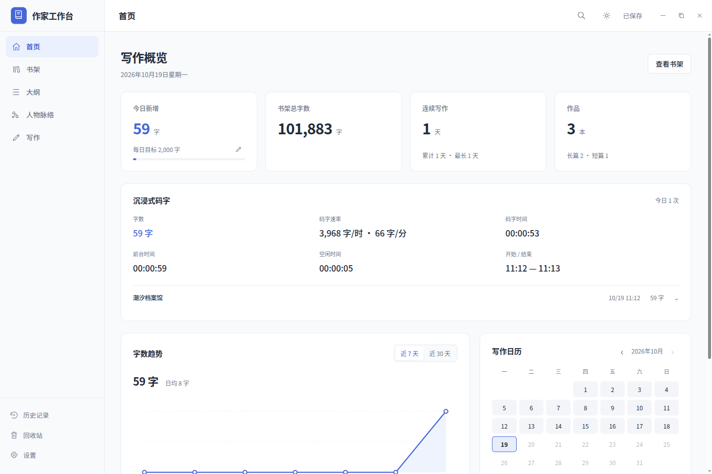

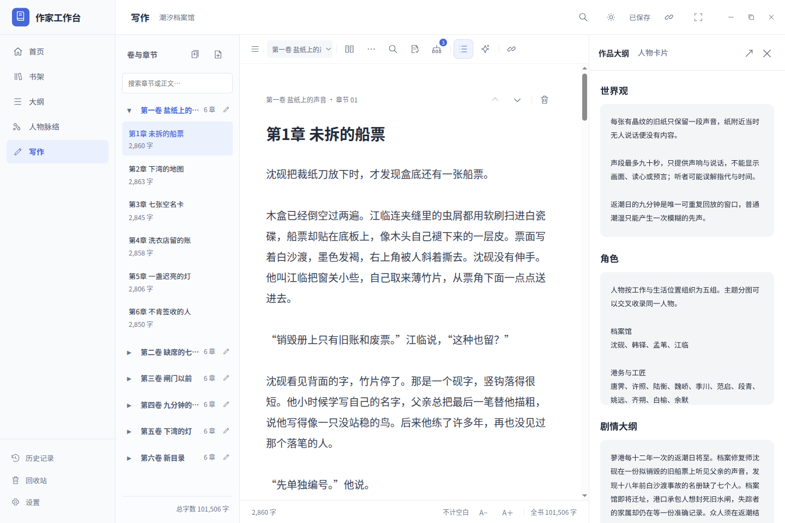

### Immersive writing

Immersive mode keeps a novel's volume and chapter directory. Use the **top-left icon** to collapse or expand it. Switching chapters within the same book saves the current chapter first and continues the same session's character count, writing time and idle time.

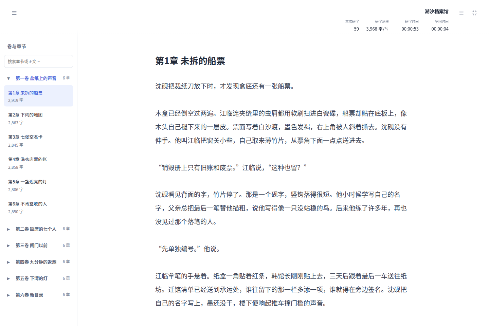

Collapse the directory for more writing space; the work outline can be opened separately. Short stories remain a single continuous manuscript.

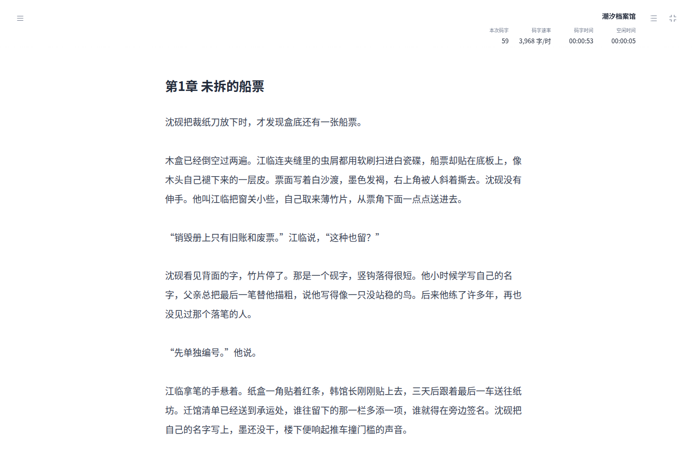

<details>
<summary>Outlines, character development and comparison drafts</summary>

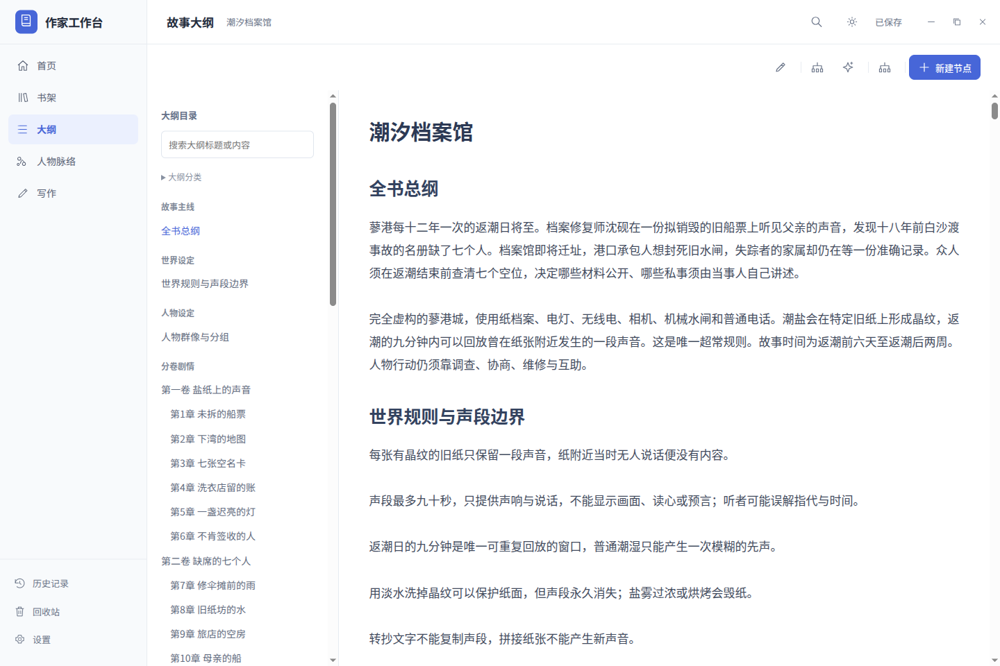

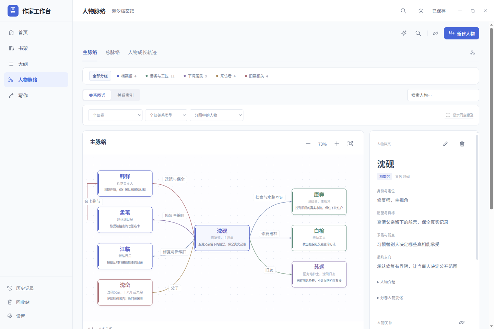

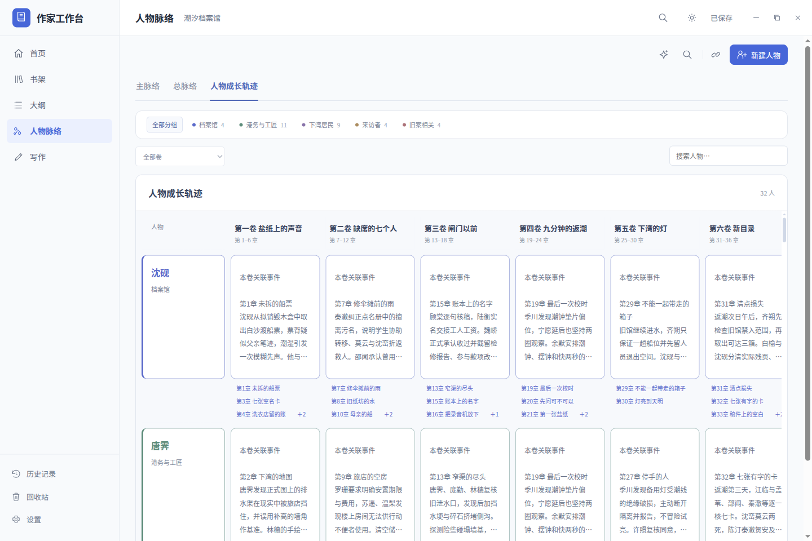

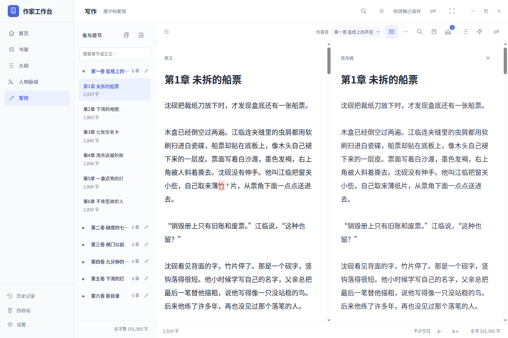

Comparison drafts stay in separate local storage. Only **Save changes** adopts them into the manuscript; closing and reopening keeps both versions.

</details>

<details>
<summary>Dark theme and mobile writing</summary>

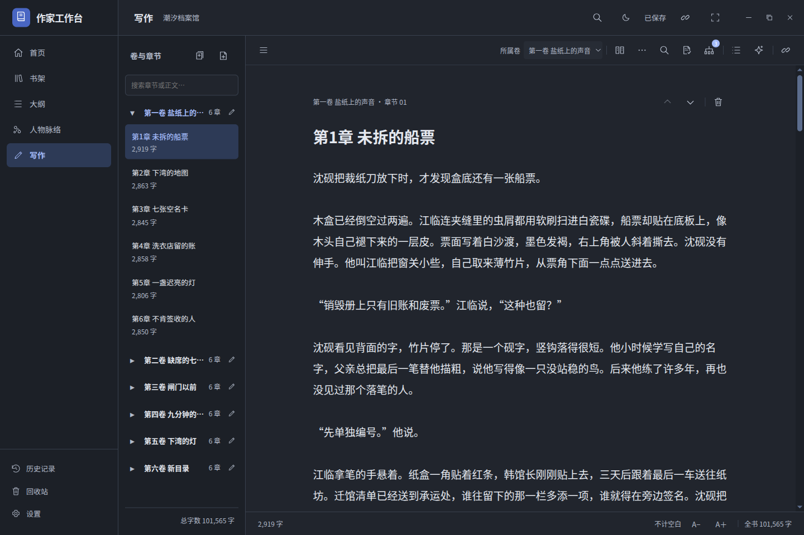


The mobile view uses the self-hosted service. Trusted HTTPS is required for PWA installation and offline startup.

</details>

<details>
<summary>Manuscript import, local proofreading and annotations</summary>

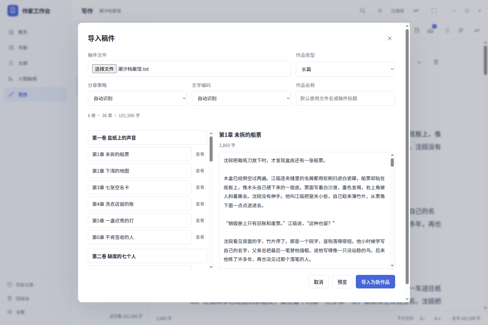

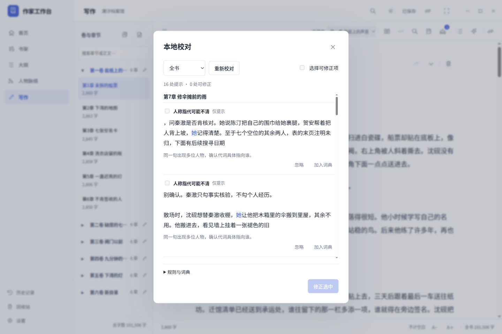

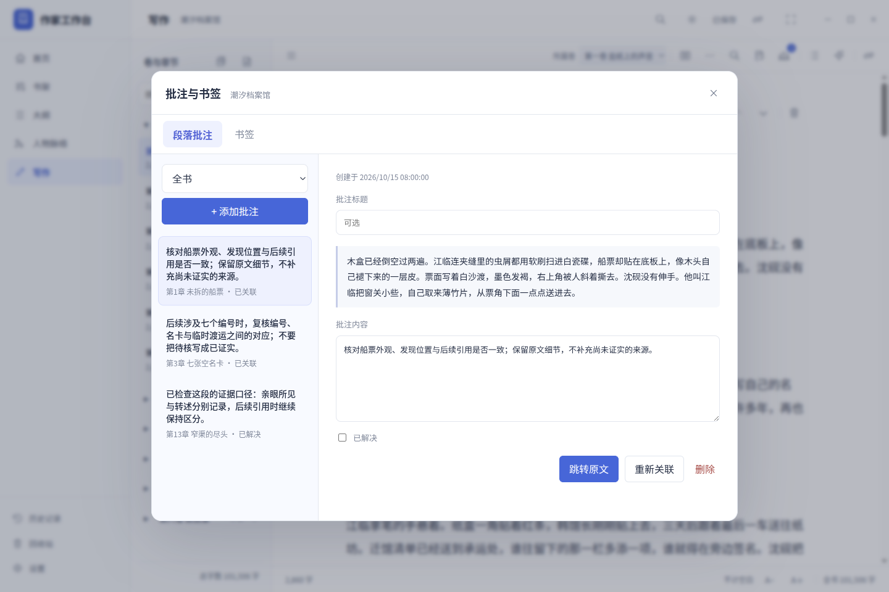

</details>

## Feature entry points

| Feature | Entry point and behavior |
| --- | --- |
| External backups | **Settings → Saving → External backups**; select an existing folder on another disk or a sync drive. Local snapshots stay enabled independently. |
| Chapter organization | **Writing tools → Organize volumes and chapters**; drag to reorder and move selected chapters between volumes. |
| Split and merge | **Writing tools → Split this chapter**, or **Organize volumes and chapters → Merge selected**; split at the caret or selection, or merge consecutive chapters. Original prose and linked records are preserved. Short stories remain a single manuscript. |
| Global search | Top-bar search icon; find prose, outlines, characters, notes and material excerpts across active books, then open the matching record. |
| Character development | **Character maps → Character development**; view characters against volumes, click a card to edit its complete text, or follow character and chapter links. Short stories use goals, flaws and outcomes without invented volumes. |
| Immersive writing | The writing-toolbar icon enters full screen. Novels retain a collapsible volume/chapter sidebar; switching chapters saves first and keeps one session. Short stories remain continuous. Optional work outline, exit summary and Home records. |
| Compare and edit | The writing-toolbar icon opens the same chapter’s original and edited drafts. Autosave and `Ctrl / Command + S` save the independent local pair. Clicking the icon again exits without applying edits; the X offers **Save changes**, **Exit without saving**, or **Cancel**. Reopening or restarting retains both drafts; explicit adoption also keeps the original and edited pair. |
| Materials library | **Writing tools → Asset library**; store images, PDFs, text and author-written web excerpts, linked to chapters or notes. |
| Enhanced proofreading | **Proofreading and annotations → Local proofreading**; additional deterministic redundancy, grammar-pattern and ambiguous-reference suggestions for manual review. |
| Multiple AI services | **Settings → AI service**; save separate endpoints, credentials and models, then switch service profiles beside the chat composer. |
| AI usage | **AI service → AI usage**; inspect actual provider token usage, request time and costs calculated from your configured prices. Unknown usage or prices remain unavailable. |
| Export templates | Each book’s **Export and backup → Formatted export**; edit paper, margins, fonts, spacing and heading styles, preview, and reuse templates for Word, EPUB and PDF. |
| In-app updates | **Settings → Updates → Check for updates**; online updates is expanded by default. Check, download, cancel and verify the platform package, then save before installation. **Update with an installer** is collapsed as a fallback. Rate-limited checks use the fixed website update feed. |
| Mobile writing | Open your self-hosted service on a phone; novels use chapters, short stories remain continuous. Writing saves locally before synchronization. |
| Self-hosted collaboration | **Settings → Sync & collaboration → Open sync settings**; start a local or LAN service, invite editors or viewers, and retain conflicting drafts for review. See the [self-hosting guide](docs/self-host-sync.md). |

Comparison drafts stay local and are excluded from per-book exports, automatic backups, book history and synchronization. Explicit **Save changes** updates the canonical manuscript, its history and normal exports; annotations and bookmarks are reanchored, and writing activity follows the normal saved-manuscript rules. If the canonical text changed elsewhere, adoption requires renewed confirmation.

Mobile PWA installation and offline startup require trusted HTTPS and a completed first cache; ordinary LAN HTTP supports online writing. Collaboration uses periodic synchronization and three-way merges, without live shared cursors. Offline disks and unavailable devices retain pending cleanup; permanent deletion cannot remotely erase an offline or revoked device. Enhanced proofreading does not provide complete semantic analysis or automatic grammar rewriting. macOS updates open a verified DMG with installation guidance.

## New in 0.7.0

| Action | Where to find it |
| --- | --- |
| Manuscript import | **Import manuscript** on the bookshelf. Choose DOCX, TXT or Markdown up to 12 MiB, preview volumes and chapters, adjust titles, then create a new book. Existing books are preserved and retries of the same confirmation do not create duplicates. |
| Local proofreading | Writing toolbar **Proofreading and annotations → Local proofreading**. Check the current chapter or whole book. Select fixes from twenty common Chinese misspelling rules; repetition and punctuation findings are suggestions only. Per-book dictionaries protect character names and aliases automatically. No network or AI request is made. |
| Annotations and bookmarks | Add or manage records from the same toolbar icon. In the manuscript editor, `Ctrl / Command + Shift + M / B` adds an annotation or bookmark for the selection, or the current nonempty paragraph. Jump, resolve or relink records; deleted or ambiguous passages become detached. |

DOCX imports text, table text and heading structure. Legacy `.doc`, images, Word comments and formatting are not imported. Full JSON includes dictionaries, annotations and bookmarks. Recycled chapters retain their records; permanent deletion removes linked quotes and context from app-managed history and snapshots. See the [Chinese user guide](docs/user-guide-zh.md#导入已有稿件).

## New in 0.6.0

| Action | Where to find it |
| --- | --- |
| Find and replace | Magnifier in the writing toolbar, or `Ctrl / Command + Shift + F / H`. Preview matches, select chapters, then apply the batch. |
| Revision comparison | Open **History → Version history & comparison**, or a book's **Export & backup → History and automatic backups**. Preview an old version, compare it with the current draft, then select paragraphs to restore. |
| Long-form memory | **Materials → Long-form memory** in AI chat. Local extracts are automatic and editable; the **Organize long-form memory** AI task produces candidates for explicit approval. |
| Foreshadows and timeline | **Story tools** in the outline or writing toolbar; planning belongs to each book. |
| Writing statistics | **Home** in the main navigation; library activity, independent goal, calendar, trends and recent books. |
| Word / EPUB / PDF | Each book's **Export and backup → Formatted export**. Keep JSON for complete, editable backups. |
| Streaming chat | Replies appear progressively in the outline and writing chat. **Stop waiting** ends the request; unfinished text is not applied to the manuscript. |

Home aggregates active books. The calendar covers 90 days; streak and lifetime writing days use the full history, with the computer's local date. It counts positive manuscript growth after successful saves; imports and full or selected-paragraph restores do not count. Counts include punctuation and exclude whitespace. Typing and autosave now retain the scroll position in long chapters. See the [user guide](docs/user-guide-zh.md) and [0.6.0 verification record](docs/acceptance-v0.6.0.md).

## Updates and installation

For routine upgrades, open **Settings → Updates → Check for updates**. Online updates is visible by default; follow the steps to check, download, verify and save before installation. Version 0.8.9 is a preview release, so enable **Include preview releases** to find it. Upgrading preserves your preference and does not enable it automatically. For offline upgrades or unavailable online updates, expand **Update with an installer** and use the fixed release-page link.

For a first installation, download the appropriate package from [GitHub Releases](https://github.com/asoming/writer-desk/releases/tag/v0.8.9). Check the [verification record](docs/acceptance-0.8.9.md) for completed platform checks. Desktop packages include the runtime; end users do not need Python or Node.js.

| Platform | Requirements | 0.8.9 installer |
| --- | --- | --- |
| Linux x64 | Ubuntu 22.04+ or a compatible Debian desktop, glibc 2.35+ | [WriterDesk-0.8.9-linux-amd64.deb](https://github.com/asoming/writer-desk/releases/download/v0.8.9/WriterDesk-0.8.9-linux-amd64.deb) |
| Windows x64 | Windows 10 / 11, 64-bit | [WriterDesk-0.8.9-windows-x64.exe](https://github.com/asoming/writer-desk/releases/download/v0.8.9/WriterDesk-0.8.9-windows-x64.exe) |
| Mac, Apple silicon | macOS 13+, M-series processor | [WriterDesk-0.8.9-mac-arm64.dmg](https://github.com/asoming/writer-desk/releases/download/v0.8.9/WriterDesk-0.8.9-mac-arm64.dmg) |
| Mac, Intel | macOS 13+, Intel processor | [WriterDesk-0.8.9-mac-x64.dmg](https://github.com/asoming/writer-desk/releases/download/v0.8.9/WriterDesk-0.8.9-mac-x64.dmg) |

- **Linux:** run `sudo apt install ./WriterDesk-0.8.9-linux-amd64.deb` in the download directory, then open 作家工作台 from the application menu.
- **Windows:** run the EXE and follow the installer. It creates desktop and Start menu shortcuts.
- **macOS:** open the DMG, drag the app to Applications, then launch it from Applications.

After the online download is verified, follow the app's save-and-install steps. If you use a fallback installer, save your work and quit the old app normally first. Personal books stay in a separate user data directory.

Only if the built-in helper in Windows 0.8.5 or earlier has already failed at **Save and open installer**, save your work, quit normally and run this release's EXE manually once. Continue using in-app online updates afterward.

The Linux [WriterDesk-0.8.9-linux-x64.tar.gz](https://github.com/asoming/writer-desk/releases/download/v0.8.9/WriterDesk-0.8.9-linux-x64.tar.gz) supports the existing per-user installation and offline updater. This release retains the 0.6.1 fix for the incomplete 0.6.0 TAR manifest; see the [0.6.1 verification record](docs/acceptance-v0.6.1.md) for the historical issue. Older user menu entries may take precedence over a new DEB installation; see [Linux installation and launcher migration](desktop/BUILD.md#run-a-linux-release) before switching installation methods.

The release page lists SHA256 checksum files and platform verification results. See the [distribution checklist](docs/distribution-checklist.md) for signing and verification details. Mac supports two-finger scrolling, map panning and pinch-to-zoom, and a save-aware swipe back to the bookshelf. Physical trackpad feel still needs hands-on verification.

## Start writing

1. Create a book on the bookshelf, or open the included **潮汐档案馆 / The Tide Archive** sample.
2. Plan the outline, characters and relationships. For a novel, generate the volume and chapter directory from the outline or create it manually.
3. Click the cover, title or **Continue writing**. A novel shows its volume and chapter directory; a short story opens a single continuous manuscript.
4. Link outline notes and character records to chapters, then follow their links to the prose. Related entries in the writing view take you back to the notes.
5. Pause typing to autosave, or press `Ctrl+S` / `Command+S`. Return to the bookshelf to switch books.
6. Use the book's **Export & backup** action to save a full JSON copy. Import that copy on another device to create a separate book.

Book titles are edited through **Cover & title** on the bookshelf. Chapter names can be edited in the directory or manuscript title; both stay in sync.

### Included sample

**The Tide Archive** demonstrates the full writing workflow and is added on first launch.

| Manuscript characters | Volumes / chapters | Characters | Outline nodes | Themed maps | Manual relationships | Foreshadows / events |
| --- | --- | --- | --- | --- | --- | --- |
| 101,506 | 6 / 36 | 32 | 49 | 6 | 35 | 12 / 18 |

The manuscript is in Chinese. The count includes all non-whitespace characters, including punctuation and Latin letters; it is not an English word count. Read the [full manuscript](examples/潮汐档案馆.txt) or inspect the [complete book data](examples/tide-archive.yejian.json). Smaller novel and short-story examples are also included.

The sample includes twelve foreshadows and eighteen events. Version 0.7.0 adds six bookmarks and three annotations, one resolved, to demonstrate navigation and record management. The original prose and setting remain unchanged. You can edit or remove the sample; restarting does not overwrite author changes. If an existing copy lacks the new planning records, **Load novel sample** creates a separate updated copy.

## Local data and backups

The desktop app stores books in SQLite under the system user data directory, separate from installed program files. Find the actual location in **Settings → About → Local data directory**.

| Platform | Default database location |
| --- | --- |
| Linux | `~/.config/writer-desk/data/writer.sqlite3`, subject to XDG configuration |
| Windows | `%APPDATA%\writer-desk\data\writer.sqlite3` |
| macOS | `~/Library/Application Support/writer-desk/data/writer.sqlite3` |
| Browser mode from source | `data/writer.sqlite3` in the project directory |

- **Per-book exports:** TXT and Markdown contain the active manuscript. Full JSON includes the cover, volumes, chapters, outlines, characters, relationships, foreshadows, timeline, legacy per-book goal, saved long-form memories and recycled content. Full v4 JSON also includes each book’s dictionary, annotations, bookmarks and embedded materials. Versions 1–3 remain importable; older apps reject v4 instead of silently dropping attachments. Import creates a new book rather than replacing an existing one.
- **External backups:** choose an existing destination in Settings; the app manages only its own marked subfolder. Offline disks do not block writing, and pending cleanup retries when they reconnect.
- **Book folders:** **Open folder** creates `正文.txt` and `作品.yejian.json` for that book and updates them after successful saves. Externally modified files are protected; their changes are not imported automatically.
- **History:** automatic snapshots are enabled by default, created after successful saves at five-minute intervals, with up to twenty per book. These settings can be changed. Preview a snapshot before restoring; the app retains the current version.
- **Deletion:** recycled books are retained for thirty days and cleaned up when due. Deleted chapter history records the deletion time and offers restore or permanent deletion. Permanent deletion clears relevant app-managed local, history, external-backup and synchronization copies. Unavailable destinations keep pending cleanup records; offline or revoked devices cannot be erased remotely. Exports you made yourself and system backups remain outside its scope.

Image and PDF materials travel with full v4 JSON; manuscript and formatted exports do not contain the entire materials library. Keep important full-book JSON backups on another disk. Activity records remain in the local database; full JSON retains the legacy per-book goal but not activity history; the new home goal is stored separately in local settings. Independent comparison drafts remain local and are excluded from per-book JSON, manuscript exports, app-managed automatic backups and synchronization. Explicitly adopted prose follows normal manuscript storage rules. AI conversations, chat images, API keys and local Skills are not included in book JSON exports. Personal databases and local configuration are excluded from source distributions. Detailed recovery and deletion behavior is documented in the [Chinese user guide](docs/user-guide-zh.md).

## Optional AI assistance

In **Settings → AI service**, configure a **Chat Completions-compatible** API base URL, key and model. The app can read the service's `/models` list; enter a model name manually if discovery is unavailable. HTTPS and local HTTP endpoints are supported.

The outline and writing pages have a streaming chat sidebar with editable preset prompts, free-form prompts and cancellation. Review generated outlines, prose, relationships, chapter memories, titles and covers before applying them. Automatic long-form memory uses local source extracts and relevant earlier chapters; changed sources mark old summaries stale. Explicitly selected manuscript material is still sent in full. Image understanding requires a vision-capable model; cover generation requires an Images API supported by the configured service.

You can keep several service profiles and switch them in chat. Usage records store provider-returned tokens, request time and optional costs without prompts or replies; prices and currencies are supplied by you.

Book context and attached images are sent only when you submit a request. Ordinary writing, saving and local mention indexing do not need AI. Context size is validated by the model service by default; the app does not impose a fixed character cap or silently truncate your material. API keys are stored in separate local configuration.

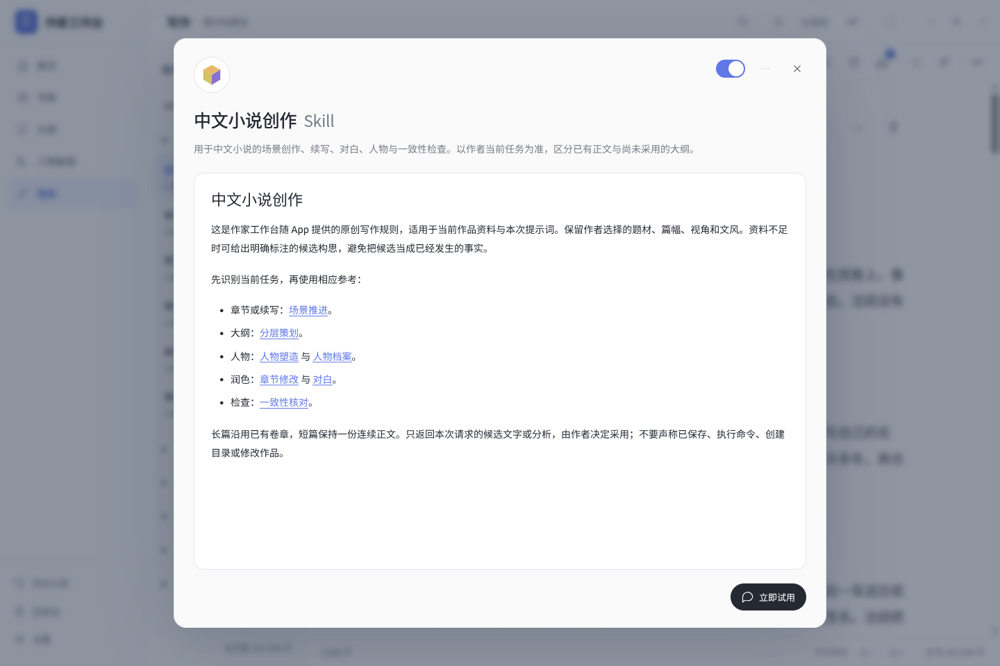

**Settings → Writing Skills** manages bundled and custom writing rules. The installers include original rules authored for this project for Chinese fiction, novel planning and natural Chinese prose. They retain the `chinese-novelist`, `novelskill` and `human-writing` IDs for compatibility with existing selections. These bundled rules work on another computer without Codex; configure your AI service URL, key and model separately on that computer.

Create, view, edit and delete custom Skills; import Markdown or an app-exported `.writer-skill.json` package; export an individual Skill to move it to another computer. File imports and AI-generated rules open as editable previews and enter the library only after you save them. A completed AI reply can also be opened with **Save as Skill**, edited and saved. Toggle default rules on or off; rule selections and the default writing task save automatically, with the previous choice restored if saving fails. Chat materials can override the selection for a request. Rules accompany only requests you explicitly send.

**View Skill** opens an article-style dialog. Follow reference links in the text or use the menu to browse reference files. **Try now** selects this Skill in the current book's AI conversation while preserving its prompt and task; it does not send a request. Select a book from the bookshelf first if none is open. In the desktop app, the menu can also show the bundled folder or local copy in the file manager.

The existing local Codex import remains available. Imported personal copies and local edits take priority over bundled rules with the same ID; restoring a bundled Skill removes only its local override. Downloaded personal Skill files are excluded from the source and installers. The app reads Markdown rules and references without executing scripts or automatically changing your manuscript. See the [Writing Skills guide](docs/user-guide-zh.md#写作-skill) for the full workflow.

<details>
<summary>0.8.9 writing Skill manager</summary>

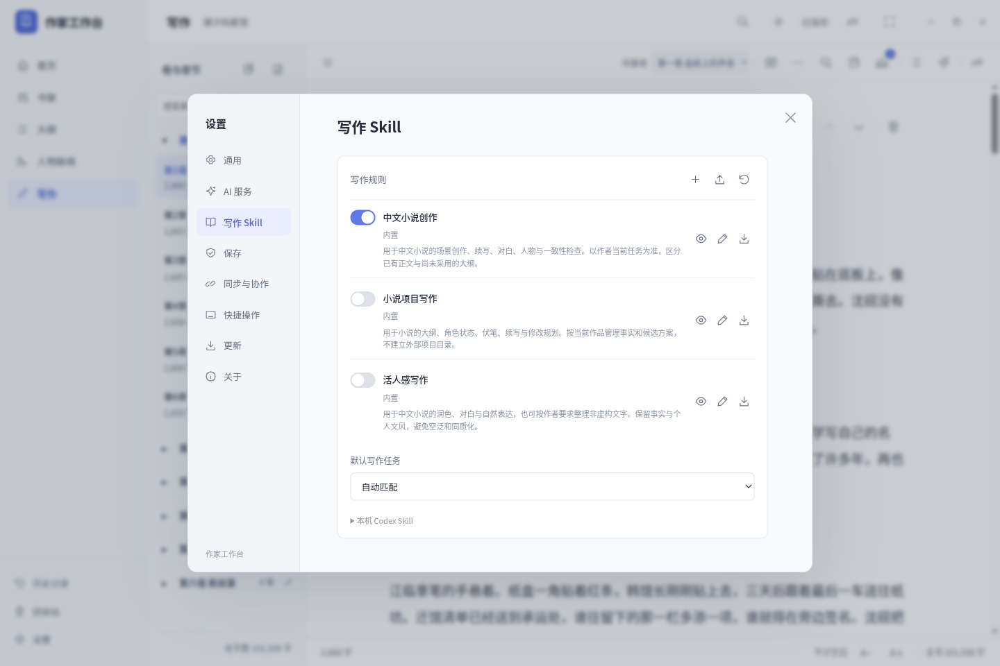

Default-rule toggles save automatically; use the **View Skill** icon to read the full rules.

</details>

## Run from source

| Use | Requirements |
| --- | --- |
| Local browser mode | Python 3.9+; the saving service uses the standard library |
| Desktop development | Node.js 22.12+, npm and Python 3.9+ |
| Self-hosted sync service | Python 3.10+; see the [self-hosting guide](docs/self-host-sync.md) |
| Native installers | The above, platform build tools and `scripts/requirements-build.txt`; Python 3.12 is recommended to match native CI |

```sh
git clone https://github.com/asoming/writer-desk.git
cd writer-desk
npm ci
npm start
```

Desktop development uses system Python by default. Set `WRITER_DESK_PYTHON` to choose another interpreter. Electron and build dependencies are pinned in `package-lock.json`.

For browser mode, run `bash start.sh` on Linux / macOS or open `start.bat` on Windows. Alternatively:

```sh
python3 server.py --open
```

Windows can use `py -3 server.py --open`. The default address is `http://127.0.0.1:8765/`, listening only on the local machine. Add `--port 8766` if needed. Keep the terminal open while writing and confirm the saved status before closing it.

### Build and verify

Build on the target operating system and processor architecture. Node.js, Python and the target architecture must match. The saving service is frozen with PyInstaller; cross-operating-system compilation is not supported.

Install npm dependencies with `npm ci`, then install Python build dependencies in a virtual environment with `python -m pip install -r scripts/requirements-build.txt`. Set `WRITER_DESK_BUILD_PYTHON` to that interpreter. Full setup is in the [desktop build guide](desktop/BUILD.md#build-from-source).

| Native build host | Command | Output in `dist/` |
| --- | --- | --- |
| Linux x64 | `npm run build:deb` | DEB, legacy TAR and checksums |
| Windows x64 | `npm run build:win` | NSIS EXE and checksums |
| macOS arm64 | `npm run build:mac -- --arch arm64` | Apple silicon DMG and checksums |
| macOS x64 | `npm run build:mac -- --arch x64` | Intel DMG and checksums |

The manually dispatched [native packages workflow](.github/workflows/native-packages.yml) builds and verifies all four targets before collecting assets into a draft release. Publishing is a separate step.

Representative checks from the project root:

```sh
python3 scripts/test-native.py
python3 tests/verify_sample.py
python3 tests/verify_workflow.py
npm run test:packaging
node --test tests/desktop-mac.test.js tests/gestures.test.js
```

On Windows, replace `python3` with `py -3` or your active environment's `python`. Storage tests use isolated temporary libraries. Installer tests run in native CI; Windows install/uninstall checks are restricted to disposable runners. AI tests use a local mock service, and automated tests do not replace physical trackpad checks or signing and notarization.

The app uses Electron, a vanilla JavaScript interface and a Python saving service. Manuscripts are plain text. Optional mobile writing and collaboration use a service you host locally or on your LAN; no third-party hosted account is required. Word, EPUB and PDF are per-book exports; the editor itself remains plain text.

## Documentation and feedback

- [Chinese quick start](docs/quickstart-zh.md): first use after installation.
- [0.6.1 packaging verification](docs/acceptance-v0.6.1.md): actual TAR installation, stable launcher and native CI.
- [0.6.0 verification record](docs/acceptance-v0.6.0.md): completed checks and remaining limits.
- [0.8.9 verification](docs/acceptance-0.8.9.md): immersive novel chapter navigation, save-before-switch and continuous session metrics; short stories stay continuous.
- [0.8.8 verification](docs/acceptance-0.8.8.md): immersive writing, real-input and idle timers, exit summaries and homepage records.
- [0.8.7 verification](docs/acceptance-0.8.7.md): primary online updates, collapsed fallback installers and the fixed cross-platform release-page link.
- [0.8.6 verification](docs/acceptance-0.8.6.md): Windows helper readiness and exit handoff, installer rechecking, stage-specific errors and retry behavior.
- [0.8.5 verification](docs/acceptance-0.8.5.md): article-style Skill dialogs, automatically saved switches, the menu and prompt-preserving Try now.
- [0.8.4 verification](docs/acceptance-0.8.4.md): portable built-in rules, custom Skill management, AI generation and saving chat replies as Skills.
- [0.8.3 verification](docs/acceptance-0.8.3.md): main and total relationships, character-development matrix, and durable comparison drafts with explicit adoption.
- [0.8.2 verification](docs/acceptance-0.8.2.md): default homepage, library statistics, aligned comparison and icon layout checks.
- [0.8.0 verification](docs/acceptance-0.8.0.md): editing, materials, backups, AI services, synchronization and update boundaries.
- [Self-hosted sync and mobile writing](docs/self-host-sync.md): LAN, HTTPS, mobile offline access and permissions.
- [0.7.0 verification record](docs/acceptance-v0.7.0.md): manuscript import, offline proofreading, annotations and bookmark tests.
- [Changelog](CHANGELOG.md): version changes and compatibility.
- [Chinese user guide](docs/user-guide-zh.md): books, outlines, characters, recovery and AI.
- [Desktop build guide](desktop/BUILD.md): development, native builds, upgrades and migration.
- [Distribution checklist](docs/distribution-checklist.md): system requirements, signing and verification scope.
- [Website maintenance](docs/website.md): static site preview, bilingual content and GitHub Pages deployment.
- [GitHub Issues](https://github.com/asoming/writer-desk/issues): report the app version, operating system, reproduction steps and expected behavior. Remove API keys and private manuscript content from logs and screenshots.

## License

The source code is licensed under the [MIT License](LICENSE). Books are saved locally by default and are not published. Optional synchronization and AI requests send data to the services you configure. Third-party interface dependency licenses are listed in [public/vendor](public/vendor/README.md).
