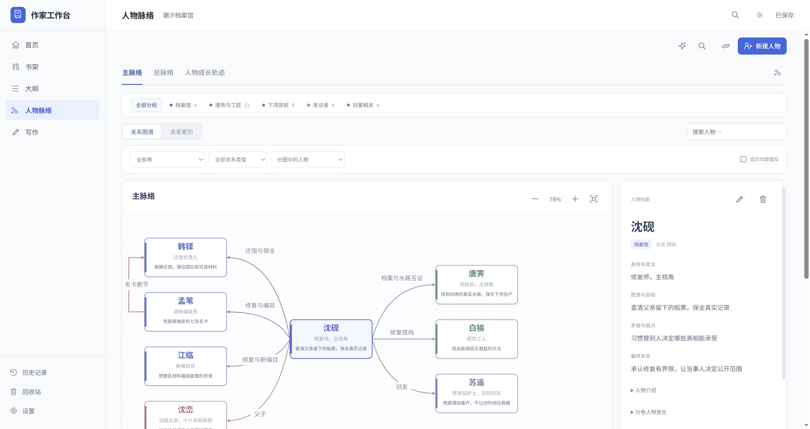
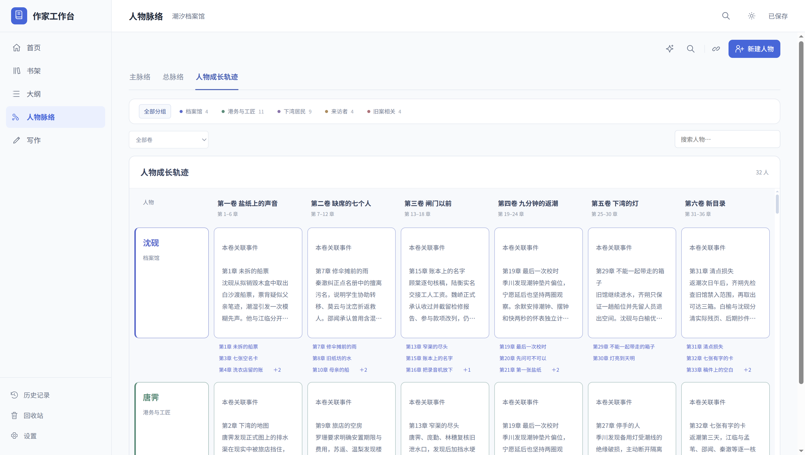
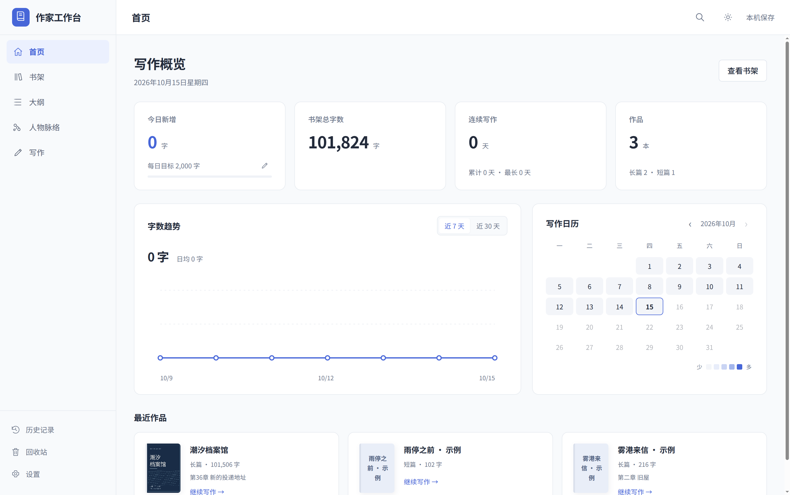
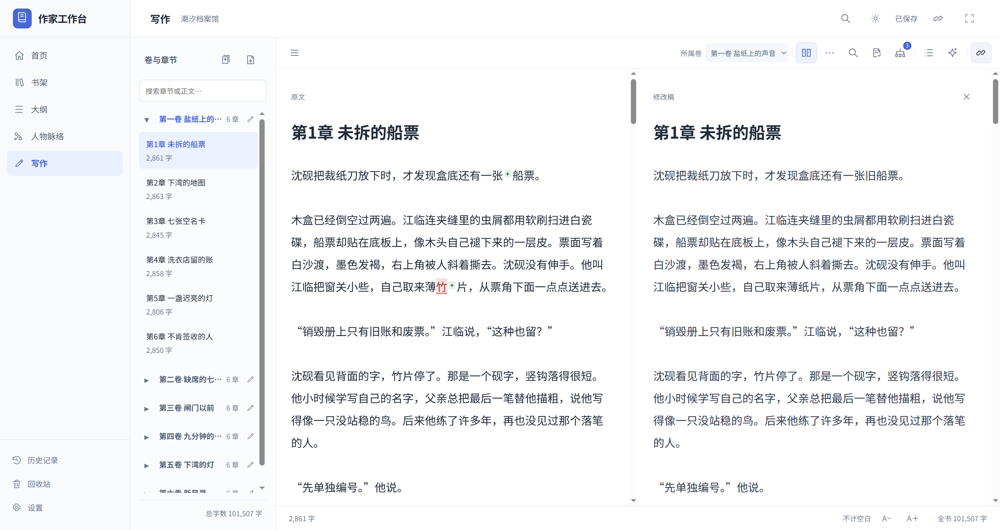
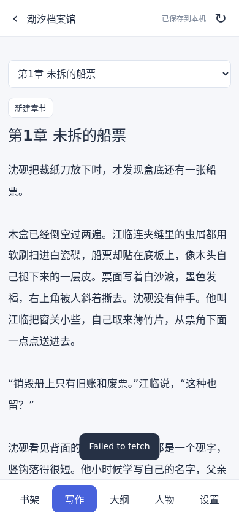
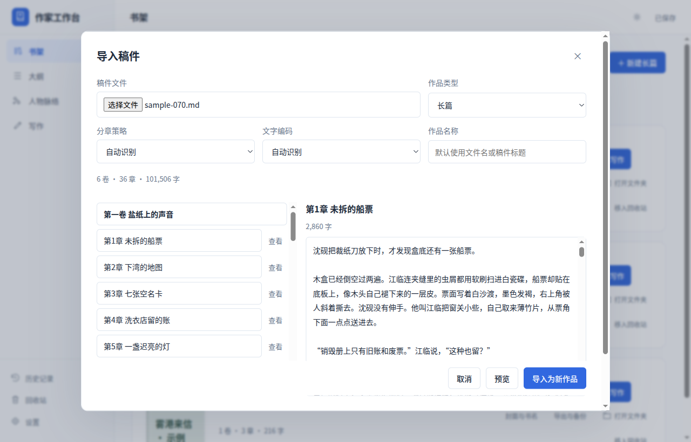
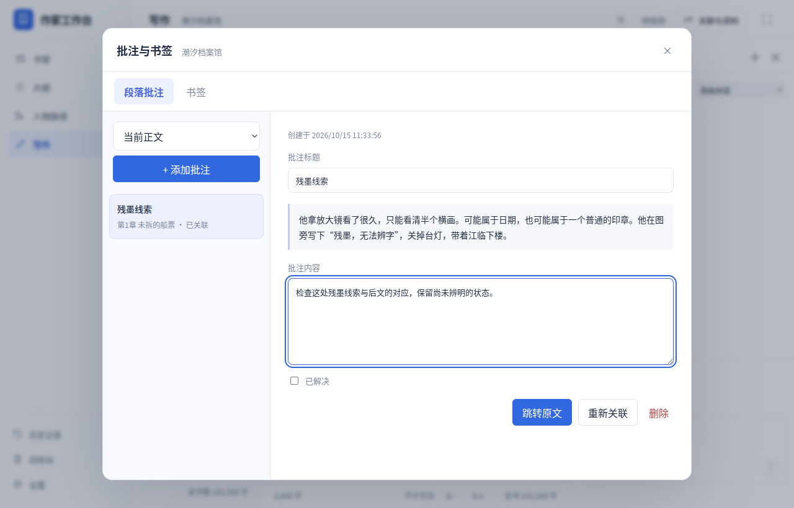

<p align="center">
  
</p>

<h1 align="center">作家工作台 · Writer's Desk</h1>

<p align="center">书架、大纲、人物与正文，在一个安静的本地工作台里。</p>

<p align="center">
  <a href="README.md">中文介绍</a> ·
  <a href="README.en.md">English guide</a> ·
  <a href="https://asoming.github.io/writer-desk/">产品官网 / Website</a> ·
  <a href="https://github.com/asoming/writer-desk/releases/tag/v0.8.4">下载 / Download</a> ·
  <a href="https://github.com/asoming/writer-desk/issues">反馈 / Feedback</a>
</p>

<p align="center">
  <a href="https://github.com/asoming/writer-desk/releases/tag/v0.8.4"></a>
  <a href="https://github.com/asoming/writer-desk/actions/workflows/native-packages.yml"></a>
  
  <a href="LICENSE"></a>
</p>

面向小说创作的本地写作 App，将书架、大纲、人物脉络和正文放在同一个工作台。支持多部作品独立管理，长篇按卷章组织，短篇使用连续正文。

写作、保存与备份可离线完成；AI 辅助按需配置。界面支持中文 / English、日夜模式和护眼模式。

*A local-first writing studio for novels and short stories, with outlines, character maps and optional AI assistance.*

[下载安装](https://github.com/asoming/writer-desk/releases/tag/v0.8.4) · [快速上手](docs/quickstart-zh.md) · [使用指南](docs/user-guide-zh.md) · [构建说明](desktop/BUILD.md) · [MIT 许可证](LICENSE)

> 当前测试版：**0.8.4**。安装包与 SHA256 校验见[发行页](https://github.com/asoming/writer-desk/releases/tag/v0.8.4)，各平台验收状态见[0.8.4 验收记录](docs/acceptance-0.8.4.md)。Windows 安装包未签名；macOS 使用临时签名，尚未进行 Apple 公证。

0.8.4 内置写作规则随安装包提供，换电脑无需 Codex；可新建、编辑、导入和导出自定义 Skill，也可让 AI 生成规则或将对话回复存为 Skill。主脉络、总脉络、人物成长轨迹与独立对照稿继续可用。

## 功能

| 模块 | 支持的操作 |
| --- | --- |
| 首页 | 全库今日新增、总字数、连续写作、写作日历、7 / 30 天趋势与最近作品；独立每日目标 |
| 书架 | 长篇、短篇分别管理；封面与书名编辑；十款封面模板、图片上传、随机书名；打开每本书的独立文件夹 |
| 大纲 | 全书、分卷、章节、情节与设定分层；主题分类与搜索；连续阅读；按大纲生成卷章目录 |
| 人物脉络 | 主脉络可选择核心成员；总脉络保留分组、关系筛选和主题分图；人物成长按卷排列、编辑并跳转正文；人物档案与别名 |
| 写作 | 长篇卷章、短篇连续正文；自动保存、拖动排序、批量移章、拆分合并、同章对照修改、全书查找替换、专注模式、可调分栏 |
| 稿件导入 | DOCX / TXT / Markdown 本地预览，调整卷章名、识别策略及编码；确认创建独立书籍，短篇连续正文 |
| 校对与批注 | 离线规则校对、每书词典；段落批注与命名书签，定位原文、标记解决及重新关联 |
| 创作工具 | 伏笔状态与未回收筛选；自定义故事时间线，按书管理人物与正文关联 |
| 数据保护 | 每本书独立导出、本机与外部自动备份、历史恢复；正文差异对比、逐段恢复；回收站与删除章节记录 |
| 素材与搜索 | 每书保存图片、PDF、文字和网页摘录，关联正文及资料；跨书搜索并跳转原记录 |
| 排版导出 | Word / EPUB / PDF；封面、目录和可复用模板，自定义纸张、字体、页边距及章节样式 |
| AI 辅助 | 多套服务配置与实际用量记录；大纲与写作对话；可编辑预设提示词和自由提示词；模型列表读取；图片输入与显示；长篇记忆、流式回复与停止生成；书名与封面生成；原创内置与自定义写作 Skill |
| 手机与协作 | 手机编辑正文、大纲和人物；可选自建同步、成员邀请、权限与冲突处理 |
| 桌面体验 | Linux、Windows、macOS 安装包；App 内下载更新与校验；中英文界面；日夜与护眼模式；Mac 原生窗口按钮及触控板操作 |

大纲、人物与正文的关联定位到**章节**，改名和排序后仍保留。姓名匹配与同章提及使用本地规则，供作者核对；人物关系可手动编写，AI 提取结果需确认后采用。

## 功能入口

| 功能 | 入口与行为 |
| --- | --- |
| 外部自动备份 | 设置 → 保存 → 外部备份；选择另一硬盘、移动硬盘或同步目录中的已有文件夹，本机快照独立保留 |
| 卷章整理 | 写作工具 → 卷章整理；拖动排序、勾选章节后批量移动到其他卷 |
| 拆分与合并 | 写作工具 → 拆分当前章；合并在卷章整理 → 合并选中。按光标或选区拆分，保留完整原文和关联记录；短篇仍是一篇正文 |
| 跨书搜索 | 顶栏搜索图标；查找活动作品的正文、大纲、人物、资料与素材摘录，打开原记录 |
| 人物成长 | 人物脉络 → 人物成长轨迹；长篇按人物与卷查看，点击卡片完整编辑，点击人名或正文链接跳转。短篇使用目标、弱点和最终去向，不划分卷 |
| 对照修改 | 写作工具栏对照图标；同一章左侧原文标色、右侧编辑。自动保存和 `Ctrl / Command + S` 保存本机独立对照稿；图标直接退出，不采用修改。右上角叉号可选「保存修改」「不保存退出」或取消；重开及重启保留两稿，确认采用后仍保留原文与修改稿 |
| 素材库 | 写作工具 → 素材库；保存图片、PDF、文字及手动填写的网页摘录，关联章节与资料 |
| 增强本地校对 | 校对与批注 → 本地校对；新增冗余表达、语句搭配及指代不明提醒，由作者判断 |
| 多套 AI 服务 | 设置 → AI 服务；保存独立地址、密钥与模型，在对话输入框旁切换服务 |
| AI 用量记录 | AI 服务 → AI 用量记录；按作品查看服务实际返回的 Token、耗时与按自填单价计算的费用，未知值显示不可用 |
| 自定义排版模板 | 逐书导出与备份 → 排版导出；设置纸张、页边距、字体、行距和章标题，预览后导出 Word / EPUB / PDF |
| 联网更新 | 设置 → 安装与升级 → 联网更新；检查、下载、取消和校验对应平台的安装包，保存退出后安装，可选择预览版；接口限流时自动使用固定官网更新索引 |
| 手机写作 | 手机打开自建服务地址，长篇按章、短篇连续编辑；先保存到本机，再同步到服务 |
| 自建协作 | 设置 → 同步与协作 → 打开同步设置；本机 / 局域网启动服务，邀请可编辑或只读成员，保留冲突原稿供处理；详见[自建说明](docs/self-host-sync.md) |

对照稿不会自动改写正式正文，也不进入逐书导出、自动备份、作品历史或同步。只有明确「保存修改」后，正式正文才进入正常历史、导出和备份；批注与书签重新定位，写作统计按正式保存的正文变化处理。正式正文已在其他位置修改时，采用前须再次确认。

手机 PWA 安装和离线启动需要可信 HTTPS，并先完成一次在线缓存；普通局域网 HTTP 可在线写作。多人协作使用定期同步与三方合并，不提供逐键共同光标。外部盘和其他设备离线时保留待清理记录，彻底删除无法远程擦除离线或已撤销的设备。本地校对不代替完整语义分析，也不自动改写语法。macOS 更新打开验证后的 DMG 安装引导。

## 0.7.0 新功能入口

| 操作 | 入口与规则 |
| --- | --- |
| 稿件导入 | 书架「导入稿件」；选择不超过 12 MiB 的 DOCX / TXT / Markdown，预览分卷分章并调整标题后，确认导入为新书。短篇保持连续，不覆盖已有作品；同一次确认重试不重复建书 |
| 本地校对 | 写作工具栏「校对与批注」图标 →「本地校对」；检查当前章或全书，20 组常见错词由作者勾选修正，重复与标点问题只提示；每书词典自动保护已有姓名及别名，不联网 |
| 批注与书签 | 同一图标添加或管理，也可在正文编辑框内按 `Ctrl / Command + Shift + M / B`；选中文字关联，未选时使用当前非空段落。可跳转、解决或重新关联，原文删除及歧义时失效 |

Word 仅导入文字、表格文字与标题结构；旧 `.doc`、图片、Word 批注和排版不导入。完整 JSON 携带词典、批注和书签；回收章节保留记录，彻底删除清理对应原文、上下文及历史 / App 自动备份。完整操作见[使用指南](docs/user-guide-zh.md#导入已有稿件)。

## 0.6.0 新功能入口

| 操作 | 入口与规则 |
| --- | --- |
| 全书查找替换 | 写作工具栏放大镜，或 `Ctrl / Command + Shift + F / H`；先看匹配预览，按章勾选后批量替换 |
| 正文差异对比 | 「历史记录 → 历史版本与差异对比」，或逐书「导出与备份 → 历史与自动备份」；预览旧版本后点「对比当前稿」，勾选段落恢复 |
| 长篇记忆 | AI 对话的「资料 → 长篇记忆」；本地自动摘录，可编辑；「整理长篇记忆」任务调用已配置 AI，确认候选后保存 |
| 伏笔与时间线 | 大纲或写作工具栏「创作工具」，按当前作品独立保存 |
| 写作统计 | 左侧「首页」；全库目标、日历、趋势和最近作品 |
| Word / EPUB / PDF | 每本书「导出与备份 → 排版导出」；排版文件不代替完整 JSON 备份 |
| 流式 AI 回复 | 大纲与写作对话逐步显示回复；「停止等待」终止本轮，未完成内容不自动写入正文 |

首页默认启动，汇总书架活动作品的写作统计，日历与趋势显示近 90 天，累计及连续写作天数使用全历史；按本机日期记录成功保存后的正文正增量；导入、整版与逐段恢复不计产量。字数均包含标点、排除空白。正文输入和自动保存保持当前滚动位置，修复了长章中打字回到顶端的问题。详见[使用指南](docs/user-guide-zh.md)和[本轮验收](docs/acceptance-v0.6.0.md)。

## 界面预览





上图为 0.8.3 实际界面，使用隔离的十万字示例作品。

<details>
<summary>0.8.2 首页与旧版对照布局</summary>





历史截图展示 0.8.2 的布局；0.8.3 对照稿改为独立保存，退出与采用规则见下文。

</details>

<details>
<summary>0.8.0 手机写作</summary>



截图来自自建服务的手机界面。安装 PWA 和离线启动需要可信 HTTPS。

</details>

<details>
<summary>历史写作界面与创作工具</summary>


[伏笔追踪](docs/foreshadows-v0.6.0.png) · [故事时间线](docs/timeline-v0.6.0.png) · [版本差异](docs/versions-v0.6.0.png) · [写作统计](docs/statistics-v0.6.0.png) · [长篇记忆](docs/memory-v0.6.0.png) · [流式回复](docs/streaming-v0.6.0.png) · [作品大纲侧栏](docs/work-plan-v0.4.14.jpg) · [图片对话](docs/chat-images-v0.4.12.jpg) · [夜间模式](docs/appearance-night-v0.4.11.jpg)

</details>

<details>
<summary>0.7.0 实际界面：稿件导入、校对与批注</summary>






截图来自隔离的十万字示例副本，记录 0.7.0 实际界面。

</details>

## 下载与安装

从 [GitHub 发行页](https://github.com/asoming/writer-desk/releases/tag/v0.8.4) 下载对应安装包。安装包可用状态与各平台检查结果见发行页和[本轮验收记录](docs/acceptance-0.8.4.md)。桌面安装包已包含运行环境，使用时无需另外安装 Python 或 Node.js。

| 平台 | 系统要求 | 0.8.4 安装包 |
| --- | --- | --- |
| Linux x64 | Ubuntu 22.04+ 或兼容 Debian 桌面环境，glibc 2.35+ | [WriterDesk-0.8.4-linux-amd64.deb](https://github.com/asoming/writer-desk/releases/download/v0.8.4/WriterDesk-0.8.4-linux-amd64.deb) |
| Windows x64 | Windows 10 / 11，64 位 | [WriterDesk-0.8.4-windows-x64.exe](https://github.com/asoming/writer-desk/releases/download/v0.8.4/WriterDesk-0.8.4-windows-x64.exe) |
| Mac · Apple 芯片 | macOS 13+，M 系列芯片 | [WriterDesk-0.8.4-mac-arm64.dmg](https://github.com/asoming/writer-desk/releases/download/v0.8.4/WriterDesk-0.8.4-mac-arm64.dmg) |
| Mac · Intel | macOS 13+，Intel 处理器 | [WriterDesk-0.8.4-mac-x64.dmg](https://github.com/asoming/writer-desk/releases/download/v0.8.4/WriterDesk-0.8.4-mac-x64.dmg) |

- **Linux：**在下载目录运行 `sudo apt install ./WriterDesk-0.8.4-linux-amd64.deb`，随后从应用菜单打开「作家工作台」。
- **Windows：**运行 EXE，按安装向导选择目录；安装后创建桌面与开始菜单入口。
- **macOS：**打开 DMG，将 App 拖入 Applications，再从 Applications 启动。

升级前先保存并退出旧版。使用系统安装包的用户，通过相应平台的新版安装包升级；作品保留在独立的用户数据目录。

Linux 另提供便携压缩包 [WriterDesk-0.8.4-linux-x64.tar.gz](https://github.com/asoming/writer-desk/releases/download/v0.8.4/WriterDesk-0.8.4-linux-x64.tar.gz)，保留既有用户安装与离线升级方式。本版保留 0.6.1 对 0.6.0 TAR 文件清单漏项的修复；历史问题与校验记录见 [0.6.1 验收](docs/acceptance-v0.6.1.md)。旧压缩包的用户菜单入口可能优先打开旧版；迁移到 DEB 前请阅读 [安装与旧图标迁移](desktop/BUILD.md#run-a-linux-release)，避免混用升级入口。

发行页列出各文件的 SHA256 校验文件、汇总清单与平台检查结果。平台签名状态、原生验收范围及 Mac 实机检查项见 [跨平台发行说明](docs/distribution-checklist.md)。Mac 支持双指滚动、人物图平移与捏合缩放，以及保存后返回书架的手势；实体触控板手感仍需实机验收。

## 快速上手

1. 在书架新建作品，或打开内置示例《潮汐档案馆》。长篇和短篇在书架中分别管理。
2. 先整理大纲、人物和关系。长篇可按大纲生成卷章目录，也可手动创建卷与章节。
3. 点击封面、书名或「继续写作」进入正文。长篇显示卷章目录，短篇直接编辑一篇连续正文。
4. 在大纲、人物资料中关联章节，点击文字跳转；正文中的关联入口可以返回相应资料。
5. 停止输入后自动保存，也可按 `Ctrl+S` / `Command+S`。切换其他作品时返回书架。
6. 使用这本书右侧的「导出与备份」保存完整 JSON。跨设备迁移时，在目标设备书架导入备份。

作品名统一在书架的「封面与书名」中修改。章节名可在目录或正文标题处修改，两处同步。

### 内置示例

《潮汐档案馆》用于展示和检查完整写作流程，首次启动自动加入书架。

| 正文字符数 | 卷 / 章节 | 人物 | 大纲节点 | 主题分图 | 手动关系 | 伏笔 / 时间事件 |
| --- | --- | --- | --- | --- | --- | --- |
| 101,506 | 6 卷 / 36 章 | 32 | 49 | 6 | 35 | 12 / 18 |

字数按非空白字符统计，包含标点和英文字母。可直接阅读 [完整正文](examples/潮汐档案馆.txt)，或查看 [完整作品数据](examples/tide-archive.yejian.json)。书架还包含简短的长篇与短篇示例。

示例已有 12 条伏笔和 18 个故事事件；0.7.0 新增 6 个书签与 3 条批注，其中 1 条已解决，用于展示跳转和管理。正文及设定保持不变。可编辑、回收或删除，重启不会覆盖作者修改或反复补入；已有示例未包含新策划时，点击「载入长篇示例」建立新版独立副本。

## 数据与备份

桌面版使用 SQLite，将作品保存在系统用户数据目录；安装与升级不将个人作品写入程序目录。可在「设置 → 关于 → 本机数据目录」查看实际位置。

| 平台 | 默认数据库位置 |
| --- | --- |
| Linux | `~/.config/writer-desk/data/writer.sqlite3`，遵循系统 XDG 配置 |
| Windows | `%APPDATA%\writer-desk\data\writer.sqlite3` |
| macOS | `~/Library/Application Support/writer-desk/data/writer.sqlite3` |
| 源码网页版 | 项目目录下的 `data/writer.sqlite3` |

- **逐书备份：**TXT / Markdown 导出活动正文；完整 JSON 包含封面、卷章、大纲、人物、关系、伏笔、时间线、旧版逐书目标、已保存长篇记忆及回收内容；完整 v4 JSON 还包含每书词典、批注、书签与内嵌素材。仍可导入 v1–v3；旧版 App 拒绝 v4，避免静默丢失附件。导入会新建作品，保留现有作品。
- **外部备份：**在设置选择已有目录，App 只管理其中带所有权标记的专有子目录。外部盘离线不阻止写作，待清理记录在重新连接后重试。
- **作品文件夹：**「打开文件夹」生成该书的 `正文.txt` 和 `作品.yejian.json`，以后随成功保存更新。外部修改过的文件会受保护，外部改动不会自动导入。
- **历史恢复：**自动备份默认开启，每 5 分钟在成功保存后生成快照，每本书保留最近 20 份，可在设置调整。恢复前先预览，并保留当前版本。
- **删除与回收：**整本书回收后保留 30 天，到期清理；章节历史显示删除时间，可恢复或确认彻底删除。彻底删除会清理 App 管理的对应正文、历史、外部备份和同步副本；不可用的位置保留待清理记录，离线或已撤销设备无法远程擦除。自行导出和系统备份不在清理范围内。

图片和 PDF 素材随完整 v4 JSON 迁移，正文及排版导出不包含整个素材库。请将重要作品的完整 JSON 另存到其他磁盘。写作活动统计保存在本机数据库，完整 JSON 保留旧版逐书目标，未包含活动记录；首页目标保存在独立本机设置中。独立对照稿只保存在本机，不进入逐书 JSON、正文导出、App 自动备份或同步；确认采用后的正式正文按正常规则保存。AI 对话、聊天图片、密钥和本机 Skill 不包含在作品 JSON 中；个人数据库与本机配置不纳入源码发行包。详细恢复与删除规则见 [使用指南](docs/user-guide-zh.md)。

## 可选 AI 辅助

在「设置 → AI 服务」配置兼容 **Chat Completions** 的 API 基础地址、密钥和模型。支持读取服务的 `/models` 列表，不支持列表的服务可手动填写模型名称。服务地址支持 HTTPS 和本机 HTTP。

大纲与写作页提供右侧流式对话栏，可停止本轮生成，使用预设任务或自由提示词；预设提示词可以修改。生成的大纲、正文、人物关系、章节记忆、书名与封面先预览，再由作者决定采用。长篇记忆默认由本机摘录原文，按相关性选取前文；正文变化后旧摘要标记过期。已勾选的正文资料仍完整发送，不以摘要替换。图片识别和封面生成分别需要服务支持相应的视觉模型与 Images API。

可保存多套服务配置，在对话栏快速切换。用量记录保存提供商实际返回的 Token、耗时和可选费用，不保存提示词与回复；单价及币种由作者填写。

作品资料和图片仅在发送请求时交给所配置的服务；正常写作、保存与本地提及索引无需 AI。上下文默认由模型服务校验，App 不设固定字符上限或自动截断资料。密钥保存在本机独立配置中。

「设置 → 写作 Skill」管理内置与自定义写作规则。安装包自带本项目原创的中文小说创作、小说项目规划和自然中文表达规则，沿用 `chinese-novelist`、`novelskill`、`human-writing` 三个 ID，兼容已有选择。换电脑后可直接选择内置规则，无需安装 Codex；AI 服务地址、密钥和模型仍需在新电脑独立配置。

可新增、查看、编辑、删除自定义 Skill，导入 Markdown 或 App 导出的 `.writer-skill.json` 技能包，再单独导出到其他电脑。导入和 AI 生成先进入编辑预览，确认保存后才加入技能库；已完成的 AI 回复也可通过「存为 Skill」继续编辑保存。勾选规则并保存默认选择，或在对话资料区临时选择后，规则才随请求交给 AI。

原有本机 Codex Skill 导入继续保留：个人导入副本及本机修改优先于同 ID 的内置规则，恢复内置版只移除本机覆盖。个人下载的 Skill 原文不进入源码或安装包。程序只读取 Markdown 规则和参考，不执行脚本、不自动修改书稿。完整操作见 [写作 Skill 使用说明](docs/user-guide-zh.md#写作-skill)。

## 从源码运行

### 环境要求

| 用途 | 前置条件 |
| --- | --- |
| 本地浏览器运行 | Python 3.9+，保存服务仅使用标准库 |
| 桌面开发 | Node.js 22.12+、npm，以及 Python 3.9+ |
| 自建同步服务 | Python 3.10+，详见[自建同步说明](docs/self-host-sync.md) |
| 原生安装包构建 | 上述环境、目标平台的构建工具及 `scripts/requirements-build.txt`；推荐 Python 3.12，与原生 CI 一致 |

获取源码：

```sh
git clone https://github.com/asoming/writer-desk.git
cd writer-desk
```

**桌面开发：**

```sh
npm ci
npm start
```

开发版默认使用系统 Python；可通过 `WRITER_DESK_PYTHON` 指定解释器。Electron 与构建依赖由 `package-lock.json` 固定。

**本地浏览器运行：**Linux / macOS 执行 `bash start.sh`，Windows 双击 `start.bat`。也可直接运行：

```sh
python3 server.py --open
```

Windows 可使用 `py -3 server.py --open`。默认地址为 `http://127.0.0.1:8765/`，仅监听本机；端口占用时添加 `--port 8766`。运行期间保持终端开启，退出前确认「已保存」。

### 构建安装包

在目标系统和对应处理器架构上构建，Node.js、Python 与目标架构须一致。保存服务使用 PyInstaller 打包，不支持跨操作系统编译。

先运行 `npm ci` 安装桌面依赖，再在 Python 虚拟环境中运行 `python -m pip install -r scripts/requirements-build.txt` 安装构建依赖。通过 `WRITER_DESK_BUILD_PYTHON` 指定构建解释器，配置步骤见 [桌面构建说明](desktop/BUILD.md#build-from-source)。

| 原生构建环境 | 命令 | 输出 |
| --- | --- | --- |
| Linux x64 | `npm run build:deb` | DEB、兼容离线升级的 TAR 包及校验文件 |
| Windows x64 | `npm run build:win` | NSIS EXE 安装包及校验文件 |
| macOS arm64 | `npm run build:mac -- --arch arm64` | Apple 芯片 DMG 及校验文件 |
| macOS x64 | `npm run build:mac -- --arch x64` | Intel DMG 及校验文件 |

产物输出到 `dist/`。原生 CI 工作流为 [native-packages.yml](.github/workflows/native-packages.yml)，手动触发后在四种原生环境中构建和验收，全部通过才收集到 GitHub 草稿 Release；发布是单独步骤。

### 验证

在项目根目录运行以下检查。Python 命令在 Windows 可替换为 `py -3`，或使用已激活虚拟环境的 `python`。

```sh
python3 scripts/test-native.py
python3 tests/verify_sample.py
python3 tests/verify_workflow.py
npm run test:packaging
node --test tests/desktop-mac.test.js tests/gestures.test.js
```

Linux 另可运行 `npm run test:desktop` 和 `node scripts/test-updater.cjs` 检查桌面入口与离线升级；需要 `desktop-file-utils` 提供的 `desktop-file-validate`。

存储测试使用隔离的临时作品库。实际安装包检查在原生 CI 中完成，Windows 安装 / 卸载测试限定在一次性 runner。AI 验收使用本机模拟服务，未调用真实付费模型；自动测试也不替代实体触控板、系统签名与公证检查。

## 项目结构

```text
writer-desk/
├── public/             界面、编辑器与人物图
├── website/            中英文产品官网（GitHub Pages）
├── desktop/            Electron 主进程、桥接与升级器
├── server.py           本机 HTTP 服务与 SQLite 保存
├── collaboration.py    自建同步服务与手机访问
├── sync_client.py      桌面同步、冲突与删除传播
├── asset_library.py    每书素材与完整备份校验
├── external_backups.py 外部自动备份与待清理记录
├── library_search.py   跨书本地搜索
├── protection.py       自动备份与历史恢复
├── chapter_history.py  删除章节记录与清理
├── comparison_drafts.py 本机独立对照稿、采用检查与删除清理
├── manuscript_import.py DOCX / TXT / Markdown 本地稿件导入
├── review_tools.py     校对词典、批注书签校验与删除清理
├── planning.py         伏笔、故事时间线与写作统计
├── story_memory.py     本地长篇记忆及相关前文选择
├── formatted_export.py Word、EPUB 与打印排版
├── ai_service.py       可选 AI 服务接入
├── skills.py           内置与自定义写作 Skill、导入导出与上下文
├── bundled-skills/     本项目原创的内置写作规则
├── examples/           示例小说与完整作品数据
├── tests/              存储、界面与流程检查
├── scripts/            原生构建与发行验收
└── docs/               使用说明、截图与验收记录
```

桌面版由 Electron、原生 JavaScript 界面和 Python 保存服务组成。正文采用纯文本；可选手机写作与协作通过自己在本机或局域网启动的服务完成，无需第三方托管账号。Word、EPUB、PDF 是逐书排版导出，编辑器本身保持纯文本。

## 文档与反馈

- [快速上手](docs/quickstart-zh.md)：安装后的首次使用。
- [使用指南](docs/user-guide-zh.md)：书架、大纲、人物、保存恢复和 AI 的详细行为。
- [桌面构建说明](desktop/BUILD.md)：开发环境、平台构建、升级与数据迁移。
- [跨平台发行说明](docs/distribution-checklist.md)：系统要求、签名状态和 Mac 验收边界。
- [官网维护](docs/website.md)：本地预览、中英文内容与 GitHub Pages 部署。
- [0.8.4 验收](docs/acceptance-0.8.4.md)：内置规则跨电脑可用、自定义 Skill 管理、AI 生成与对话存为 Skill。
- [0.8.3 验收](docs/acceptance-0.8.3.md)：主脉络、总脉络、人物成长矩阵及独立对照稿保存与采用。
- [0.8.2 验收](docs/acceptance-0.8.2.md)：默认首页、全库统计、对照布局与图标整理。
- [0.8.0 验收](docs/acceptance-0.8.0.md)：章节整理、素材、备份、AI 服务、同步及更新的实现与验证边界。
- [自建同步与手机写作](docs/self-host-sync.md)：局域网、HTTPS、手机离线及成员权限。
- [0.7.0 功能验收](docs/acceptance-v0.7.0.md)：稿件导入、本地校对、批注与书签的示例和测试范围。
- [0.6.1 打包修正版验收](docs/acceptance-v0.6.1.md)：真实 TAR 安装、固定入口及四平台原生检查。
- [0.6.0 功能验收](docs/acceptance-v0.6.0.md)：上一轮功能验证、测试入口和验收边界。
- [更新记录](CHANGELOG.md)：版本变化与兼容规则。

可在 [Issues](https://github.com/asoming/writer-desk/issues) 反馈问题。请附 App 版本、操作系统、复现步骤和预期行为；日志与截图请先移除密钥和私人作品内容。

## 许可证

源代码采用 [MIT License](LICENSE)。作品默认保存在作者本机，不公开正文与资料；启用同步或发送 AI 请求时，数据交给作者配置的服务。第三方界面依赖的许可证见 [public/vendor](public/vendor/README.md)。
