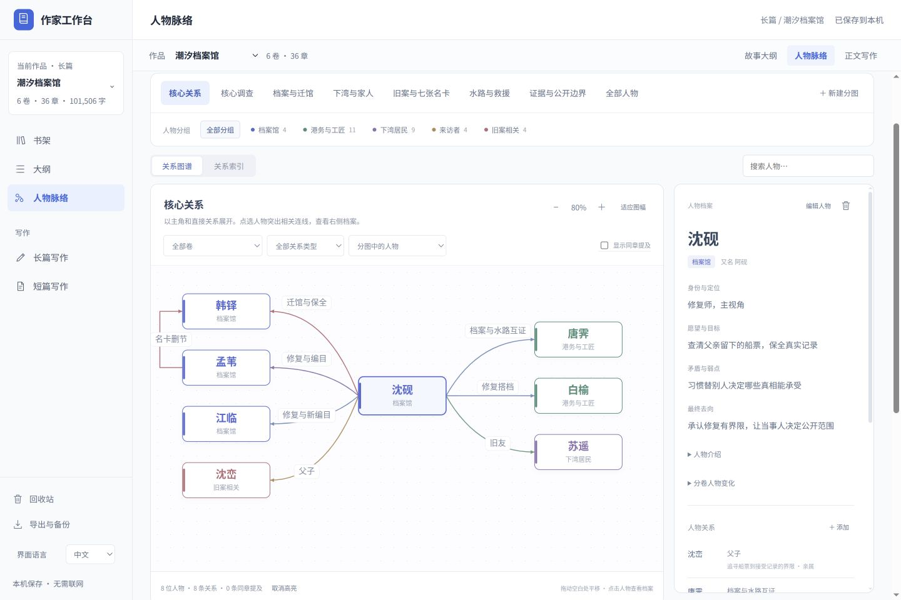

# 作家工作台 0.3.0 验收记录

验证日期为 2026-10-09。本版重点修正人物图与完整大纲的分类、阅读层次和导航。原 0.2.0 的小说与保存验证保留在 [历史记录](acceptance-0.2.0.md)。

## 参考结构与实际改动

对照用户提供的两份本地 HTML 后，确认原版缺失的不是单一配色，而是主题分图、人物分组、关系类型三套分类，以及按内容主题组织的大纲。新版保留白底、轻边框和少量蓝色。用户原参考 HTML 及其中小说内容未复制进仓库。

人物图提供核心图、整书网络和用户自定义的主题分图。人物可跨主题出现，分组使用统一颜色；卷、关系类型和直接关系范围可组合筛选。核心图突出主角与关系，大图采用离线 Dagre 布局。右侧默认阅读人物档案，编辑另有入口。分卷推进卡与完整关系表分别展示故事阶段和关系变化。

大纲增加九个内置主题及自定义分类，主题、结构层级和卷分别筛选。完整阅读版采用左目录和右正文，包含分卷概览、段落排版、章节入口和编辑入口。

## 用完整示例验证

《潮汐档案馆》仍为六卷、36 章、32 位人物、35 条手动关系。新增主题策划后为 **49 个大纲节点、8 个有内容分类、6 个主题分图**。36 章正文逐项与 0.2.0 相同，TXT 全文字节未改变，正文仍为 **101,506 个非空白字符**，其中汉字 90,925 个。

已有旧示例不会被自动覆盖。书架再次载入示例将创建新版独立副本；旧作品无需迁移即可新建分图和编辑分类。

## 发现并修正的问题

| 问题 | 修正与验证 |
| --- | --- |
| 节点按圆圈或网格摆放，连线缺少层次 | 核心图以主角为中心，其他图按有向关系分层排布；32 人/35 关系及 441 同章提及布局测试通过 |
| 同一对人物多条关系重叠 | 检测并行关系后采用独立路线和标签位置，回归测试验证区别 |
| 换卷后仍高亮已隐藏人物，当前图全部变淡 | 筛选后清理不可见的高亮对象，档案与图同步 |
| 分组扩展可能随关系记录顺序变成多跳 | 固定用原分组种子只扩展一跳，重排关系后结果一致 |
| 只被分图引用的人物改成地点后无法保存 | 类型转换同时保护分图和关系引用，实际 change 事件回归通过 |
| 从正文返回折叠章纲，左目录无当前项 | 仅展开目标祖先，保留其他分支折叠；阅读模式定位目标节，真实界面和回归测试通过 |
| 分类、分图可能在作品切换时串用 | 每本书独立持久化；清理筛选、高亮、搜索状态，真实界面重开和跨书测试通过 |

## 检查结果

| 检查 | 结果 |
| --- | --- |
| `python3 tests/verify_api.py` | 15 组通过，保存、冲突、回收、关联、旧备份升级等保持兼容 |
| `python3 tests/verify_categories.py` | 主题分图与大纲分类保存、重载、导出、导入通过；错误引用原子拒绝 |
| `python3 tests/verify_sample.py` | 完整小说结构与正文、备份映射、独立副本和跨书隔离通过 |
| `node tests/atlas-layout.test.js` | 重复布局稳定、无节点重叠、路线端点、循环、反向和并行关系通过 |
| `node tests/atlas-ui.test.js` | 8 组真实状态/事件回归通过 |
| `node tests/outline-ui.test.js` | 28 项主题/层级组合、卷继承、阅读锚点、分类保存和回跳回归通过 |
| `node tests/i18n.test.js` | 中英文文案、内容隔离、语言切换锁定和失败恢复通过 |
| `node tests/story-analysis.test.js`、`node tests/sample-analysis.test.js` | 姓名提及和完整小说索引通过，手动关系与 441 组同章提及分开 |
| 冻结服务 desktop/categories/sample 检查 | 三组全部通过 |
| 最终原生 Electron App | 无外部 Python/Node PATH 下加载，渲染沙箱启用，退出后子服务清理通过 |
| 分发内容 | 15 个前端文件递归逐字节匹配源码，包含新增图谱、大纲、Dagre 及许可证，不含个人数据库 |

真实浏览器另验收了自定义分图保存和重开、不同作品隔离、主题与卷筛选、关系表、人物与正文往返、自定义大纲分类保存，以及中文/英文在 390×844 和桌面窗口下的布局。截图来自同一份前端，原生桌面包另外完成启动检查。

## 交付与边界

Linux x64 最终包为 `WriterDesk-0.3.0-linux-x64.tar.gz`，130,678,688 字节，SHA256 为 `337bc2fcd5578e1bfb33390a8a896a7605e86d3ae92f959230787aaca061d66e`。解压新版并启动，不会自动替换手工解压的旧目录。作品仍保存在系统用户数据目录。

当前仍按章节跳转，暂不跟踪随正文编辑移动的段落锚点。正文可自动建立姓名提及和同章提及索引，语义关系仍由作者确认；不接入 AI。Windows/macOS 仍只有构建配置，尚未验证安装包。
