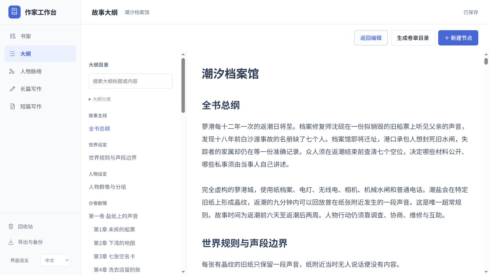
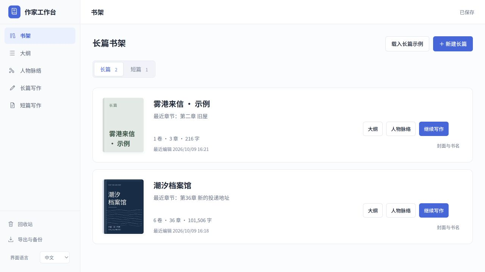

# 作家工作台 0.3.1 验收记录

验证日期为 2026-10-09。本版精简界面、统一书架选书，并把大纲阅读改成连续文档。分类与人物图的前版验证见 [0.3.0 记录](acceptance-0.3.0.md)，小说与保存功能见 [0.2.0 记录](acceptance-0.2.0.md)。

## 实际改动

删除左侧当前作品卡、顶部作品下拉框与重复工作区标签、重复书名和统计、引导说明。书架保留封面、书名、卷章字数、最近章节与编辑时间。左侧菜单进入当前作品的大纲、人物和正文；换书统一返回书架点击封面或书籍入口。跨长短篇导航先进入对应书架，无自动选书。启动恢复目标已不存在时回到书架，不选第一本替代。

完整大纲采用左文字目录和右连续正文。目录每项有稳定节锚点，点击定位；正文标题可点击编辑该节，关联章节为普通文字链接。删除分卷概览卡、正文分类框、层级标签、独立编辑按钮。搜索保留，主题、层级与卷筛选默认收起。编辑视图仍保留完整层级与分类管理。

## 回归验证

| 检查 | 结果 |
| --- | --- |
| `node tests/atlas-ui.test.js` | 13 组通过，包含真实 HTML ID、实际菜单事件、跨类型不自动换书、保存失败阻止切换、恢复目标丢失回书架 |
| `node tests/outline-ui.test.js` | 38 组通过，连续排版、稳定文字锚点、筛选目标、标题编辑、折叠祖先展开、正文链接与来源回跳；普通/减少动画时目录只滚动自身，保留正文位置 |
| `node tests/i18n.test.js` | 界面翻译、作品内容隔离、语言切换保存与编辑锁通过 |
| `node tests/atlas-layout.test.js` | 32 人 / 35 手动关系及 441 同章提及，布局稳定、无节点重叠与并行路线通过 |

真实浏览器验证了两本书经书架显式切换、大纲与人物保持当前作品、跨长短篇进入书架、第 17 章目录定位与正文来回、点击标题编辑，以及中文桌面和 390×844 窄窗口下的中英文显示。移除作品栏后，移动章节目录贴齐顶栏；页面无横向溢出，人物大图独立滚动。浏览器无错误或警告日志。

## 数据与发行包

本次未修改保存后端、数据结构或示例内容。《潮汐档案馆》仍为 6 卷、36 章、32 位人物、49 个大纲节点、8 个有内容分类、6 个主题分图、35 条手动关系；正文为 101,506 个非空白字符。旧作品在系统用户数据目录继续保留。

冻结后端的 desktop/categories/sample 及完整 15 组 API 兼容性检查通过。发行包验证其前端文件逐字节匹配最终源码，不含个人数据库。最终原生包复验版本 0.3.1、无外部 Python/Node PATH 加载、渲染沙箱启用及退出后子服务清理均通过。15 个前端资产（包括最终目录滚动修复）与源码逐字节相同，示例及桌面文件一致。

Linux x64 包为 `WriterDesk-0.3.1-linux-x64.tar.gz`，130,674,560 字节，SHA256 为 `b383170b61c2522376729be226348f2f2cf3bedda19b9f49d9976d59d87c513b`。退出旧程序后解压并运行新版；旧作品继续使用系统用户数据目录。

本版仍按章节进入正文，大纲目录定位到对应大纲段落。自动提及采用本地姓名匹配，语义关系仍由作者确认；无 AI。Windows/macOS 只有构建配置，尚未提供验证过的安装包。
