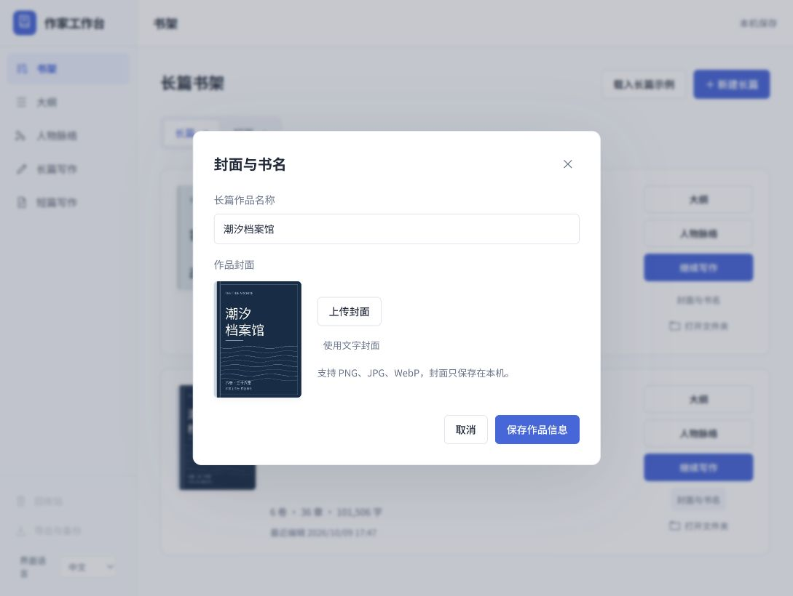

# 作家工作台 0.3.4 验收记录

本版修复书架点击「封面与书名」先跳转到大纲的问题。原按钮复用了打开作品的导航流程；现在独立读取指定作品，在书架上直接打开编辑框。保存和取消均保留当前页面、长短篇分类、当前作品及选择。只更新目标作品的标题和封面，正文、卷章、大纲、人物与关联保留。

## 验证

`node tests/book-settings-ui.test.js` 共 9 组通过，覆盖中英文、长短篇取消不导航、正确作品与独立修订号、正文草稿先保存、表单打开后新增正文不被旧快照覆盖、当前选择保留、保存失败及冲突保留输入、封面上传及文字封面、加载失败和输入法边界。

保存 API 15 组、既有文件夹入口 11 组、连续大纲 38 组与中英文测试通过。实际隔离浏览器验证长篇和短篇均可直接编辑并保存书名，取消保持书架；刷新后书名仍保留，默认完整小说保持 101,506 字。截图展示编辑框后仍为书架。

本版未改后端保存格式、默认示例小说或人物图。文件夹功能及 0.3.3 验证详见 [0.3.3 记录](acceptance-0.3.3.md)。个人作品数据库、草稿与用户作品文件夹不进入发行包或 GitHub。
