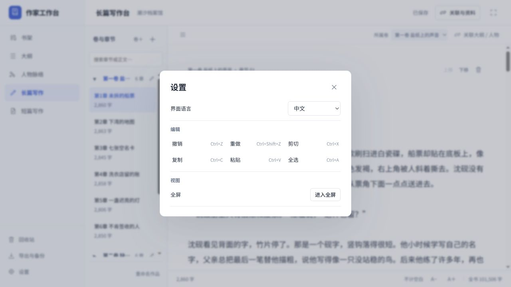

# 作家工作台 0.3.5 验收记录

顶部系统标题栏和「文件 / 编辑 / 视图 / 帮助」菜单已移除。最小化、最大化、关闭融入现有 App 顶栏；顶栏可拖动窗口。左下角增加「设置」，集中提供语言、编辑命令、缩放、全屏、版本、数据目录和退出。回收站与导出入口保持原位。

## 验证

设置 UI 回归 8 组通过，覆盖作品与章节选择保持、文本焦点与选区恢复、编辑后的草稿保存、只读及输入法保护、重复操作拦截、语言切换期间锁定、窗口状态通知和事件退订。浏览器全选直接设置输入框选区，不通过 execCommand。既有书架编辑、文件夹入口、连续大纲、人物图及中英文回归共 73 组通过。

桌面 contract 检查无边框窗口与菜单移除、可信窗口和操作白名单、编辑快捷键、缩放范围、全屏与窗口控制，以及保存失败时保留窗口。发行包使用隔离数据目录验证启动与默认小说，不访问用户作品库。

真实隔离浏览器检查左下角设置、中英文切换后书架保留、关闭设置时编辑焦点恢复、全屏切换、回收站与导出入口，以及设置弹窗布局。截图展示共享前端的内置设置；桌面专用缩放、关于、数据目录及退出仅在桌面 App 中显示。

浏览器自动化点击全选时，同步日志确认文字保持且完整选中，随后自动化通道产生额外的可信 Backspace 输入。该后续输入未作为产品全选行为计入验收；选区与文字保持另外通过 UI 回归验证。产品保留用户全选后正常删除文字的行为。所有检查均使用隔离示例，不涉及个人作品。

默认《潮汐档案馆》正文和备份未改变，仍为 101,506 字、6 卷、36 章、32 位人物。作品存储格式未改变；个人数据库、草稿和作品目录不进入发行包或 GitHub。上一版书架编辑验证见 [0.3.4 记录](acceptance-0.3.4.md)。
