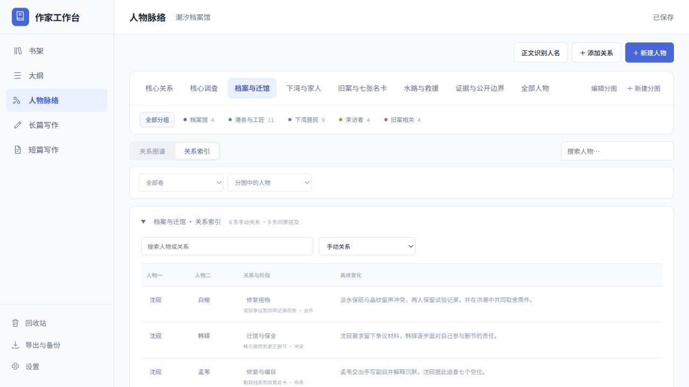

# 作家工作台 0.3.6 流程验收记录

使用完整《潮汐档案馆》检查从构思到备份恢复的写作流程。原始示例仍为 101,506 个非空白字符、6 卷、36 章、32 位人物、49 条大纲、6 个主题分图和 35 条手动关系；示例 JSON、TXT 均未改动。

## 已修复的问题

- 从章纲创建正文时，会建立尚未生成的计划卷，避免章节误入第一卷。补建较早的章节按同卷章纲顺序插入，不改已有正文及其顺序。
- 总纲下新建子节点时，长篇默认卷纲、短篇默认章纲，卷纲下默认章纲。
- 批量生成目录、正文识别人名、新书首存和新建分图遇到保存失败时，保留对话框并提示重试。重复点击和失败后重试不再重复生成目录、作品、人物或分图。
- 人物关系索引遵循主题、人物分组、卷与邻居范围。索引使用自己的关系类型筛选，不再受隐藏图谱开关影响；从索引点人物回图时清除旧的类型过滤。
- 调整卷顺序后，书架的最近章节与实际卷章阅读顺序一致，回收章和回收卷不参与正文统计及导出。

## 实际界面操作

所有操作在独立测试数据库和示例副本中完成，不访问个人作品库。

1. 从书架载入独立十万字副本，检查连续大纲、分类和六卷目录。
2. 从大纲进入第 23 章，修改标题和正文，再返回原大纲位置。刷新后文字、标题、保存状态均正确；全文搜索能找到新写段落。
3. 新增一章并编写正文，移到第六卷、调整顺序、移入回收站并恢复。重开后保留正文、卷归属及恢复位置。
4. 人物索引选择“档案与迁馆”显示 6 条手动关系，按第一卷筛选为 5 条。从关系详情打开第 23 章，再返回人物脉络，保留分类。
5. 新建长篇，先写第二卷卷纲和子章纲，再单独创建正文。结果归入第二卷，策划保留、正文初始为空。短篇采用章纲直接进入正文，无分卷控件。
6. 书架长短篇切换、封面与书名编辑框独立打开；每本书保留文件夹入口。
7. 从界面下载完整 JSON，再恢复为新作品。原副本与恢复副本正文逐章一致，均为 101,562 字、37 章（含本次验收修改）；原始示例仍为 101,506 字。数据库完整性检查为 ok。

## 回归与存储验证

新增大纲流程 11 项、人物流程 9 项通过，覆盖未建卷单章创建、补建顺序、失败重试、主题/卷/分组筛选、自动提及和人物与正文往返。既有 JavaScript 测试共 11 个文件通过；追加人物修复后对应 UI、布局、正文分析和完整示例分析再次通过。

新增 Python 流程回归 3 组通过，覆盖完整示例编辑与重启、整卷回收恢复、备份引用重建、多窗口冲突另存、作品文件夹外部改动保护，以及长短篇先策划后写作。API 15 项、作品文件夹 15 项、默认示例迁移 12 项和完整示例验证通过。测试验证其他书籍的正文、版本与更新时间保持不变。

六卷反转回归中，旧版错误显示第 36 章，新版按实际顺序显示第 6 章，正文仍为 101,506 字；另覆盖未分卷、回收卷章、空章节与短篇。

## 桌面发行

Linux x64 0.3.6 使用最终源码重新构建。冻结服务的桌面契约检查、隔离原生启动、默认完整示例、渲染沙箱及退出后子服务清理通过。发行包内 15 个前端资产、2 份示例和桌面主进程/预加载代码与源码一致；不含个人数据库或草稿。

本机继续使用固定启动入口，原图标切换到新版。界面截图来自与桌面版共用的前端；原生窗口另做隔离启动验证。数据仍保存在原用户目录。

上一版设置与窗口验收见 [0.3.5 记录](acceptance-0.3.5.md)。
