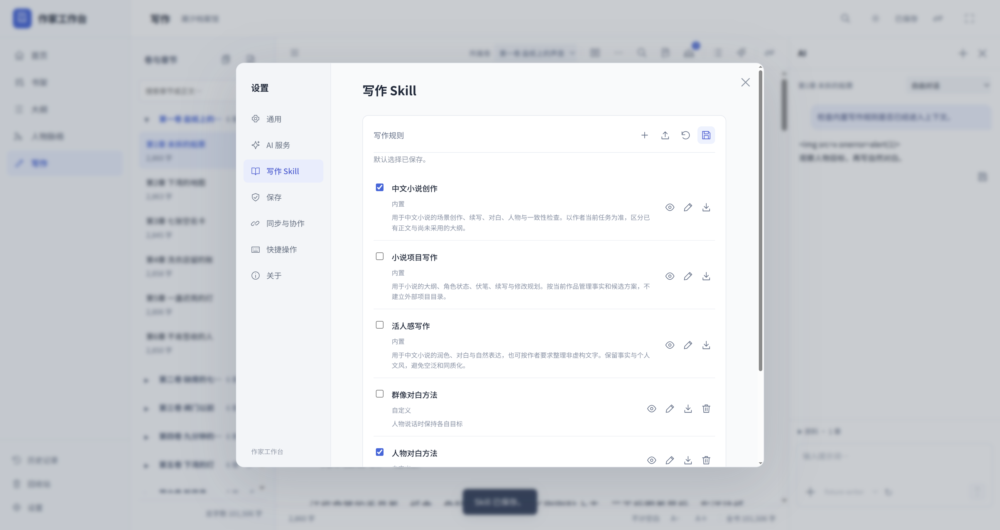

# 作家工作台 0.8.4 验收

## 本轮范围

- 安装包自带三套 App 原创写作规则与参考资料，不依赖原电脑的 Codex 目录。
- 本机已导入的同名规则优先保留；编辑内置规则保存为个人副本，可恢复内置版。
- 自定义 Skill 支持新建、编辑、Markdown / JSON 导入预览、导出、删除和重启保存。
- AI 生成只返回可编辑候选，确认保存后才进入规则库；完成的 AI 对话回复可存为 Skill。
- 规则可在大纲、写作和封面辅助中选择。Skill 不执行脚本，不携带 API 密钥或书稿。

## 隔离验收

全部测试使用临时作品库、空 Codex 目录和模拟 AI 服务，没有调用收费 AI 或使用真实用户书稿。

`verify_skills_frozen.py` 覆盖以下七组真实 HTTP 流程，支持源码与 `--service` 冻结程序：

1. 没有个人 Skill 时，三套内置规则可以读取。
2. 三套规则 × 六种任务的预览，与 18 次实际 AI 请求中发送的内容一致。
3. 自定义规则的创建、编辑、默认选择、冲突处理与重启保存。
4. Markdown / JSON 导入预览不写入；导出仅包含规则及参考文本。
5. 个人覆盖规则重启保留，恢复内置规则正常。
6. 自定义多层参考文件实际进入 AI 上下文。
7. AI 生成使用所选模型与服务，只返回候选；不读取书稿、不改变服务设置、不自动保存规则。

三套 App 规则共 18 个 Markdown 文件，内部引用全部完整。独立审查发现的自定义嵌套参考遗漏与选择数量不一致已修复并添加回归检查。

原生界面检查覆盖规则管理、导入预览、编辑、AI 生成后保存、对话存为 Skill、上下文实际使用与重启。51 个 Node 测试文件、41 套 Python 源码回归及 7 组实际桌面 Skill 流程已通过。新增界面检查包含 68 项 AI 设置 / 候选检查与 50 项对话检查，覆盖中英文、1440 / 1024 / 540 像素、夜间与护眼主题、提示词自动增高及无手动拉伸角标。

审查发现的导入文件大小不一致和关闭设置后的晚到编辑弹窗已修复并加入回归；规则行使用单条分隔线。四平台安装包检查结果将在完成后补充，当前记录不表示安装包已经发布。

## 使用边界

Skill 是写作规则文本，作为选定 AI 请求的上下文，不是可执行插件。只导入 Markdown 或 App 导出的规则 JSON，不安装脚本。

新电脑仍需配置自己的 AI 接口、模型与密钥。App 内置规则为本项目原创内容；用户原先下载的第三方 Skill 不会自动进入公开源码或发行包。个人 Skill 可单独导出迁移，不包含在作品 JSON 备份中。

## 实际界面

