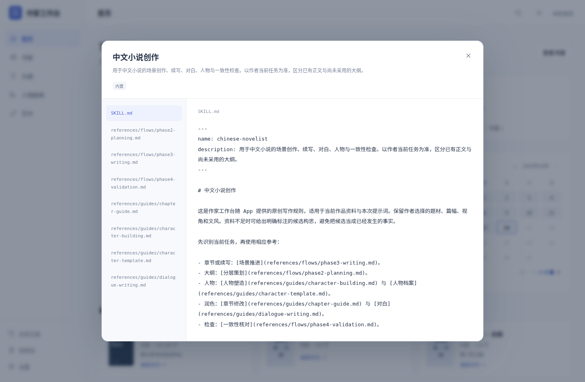

# 作家工作台 0.8.5 验收

## 本轮范围

查看 Skill 使用独立只读弹窗。点击立即打开加载状态，默认显示 `SKILL.md`，可切换参考文件；叉号和 Esc 关闭后回到原设置位置。界面沿用 App 的日夜、护眼与中英文设置。

弹窗不保存规则、不修改作品、不调用 AI。规则文本仅作为文字显示，HTML 和脚本不会执行。一次只显示一个文件正文，避免为长文档创建大量节点。

关闭、切换设置页、关闭设置、打开编辑器或另一个弹窗，都会使旧查看失效；迟到响应不会重开旧窗口或覆盖新的文件。读取失败在当前弹窗内显示，仍可正常关闭。

## 验收状态

隔离交互检查覆盖立即弹窗、只读主规则与参考文件、X / Esc 关闭与焦点恢复、原设置滚动位置、错误、并发与迟到响应。原生窗口检查还覆盖 540 / 1024 像素、长参考文件的鼠标滚轮、夜间与护眼模式、英文内置标题与作者自定义名字。

使用临时作品库和空 Codex 目录，保留 101,506 字示例的正文与规则管理完整流程；未使用真实用户书稿或收费 AI。72 项 AI 界面检查、51 项对话检查及 11 组原生流程通过；全量前端回归覆盖 51 个测试文件。原生安装包检查结果在完成后补充。

## 实际界面

