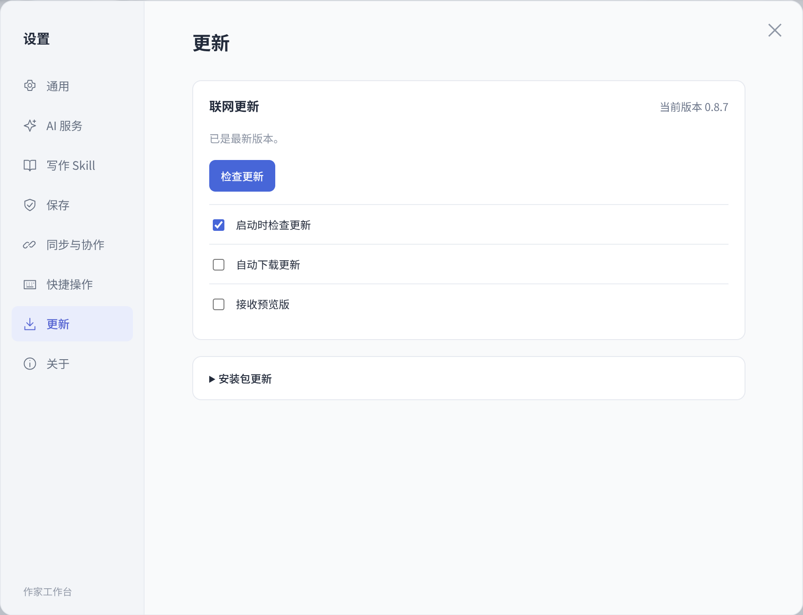
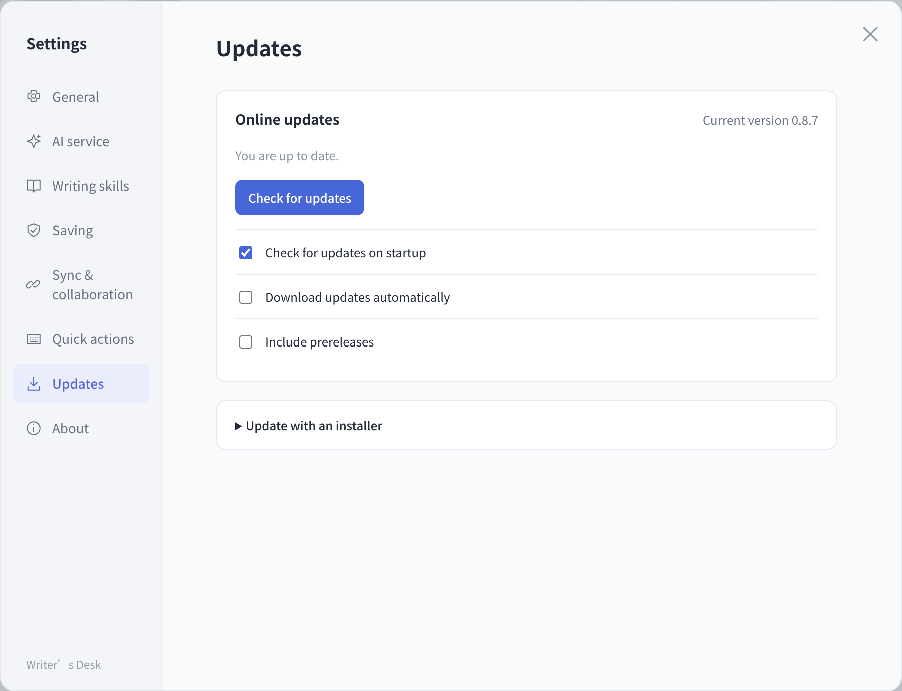
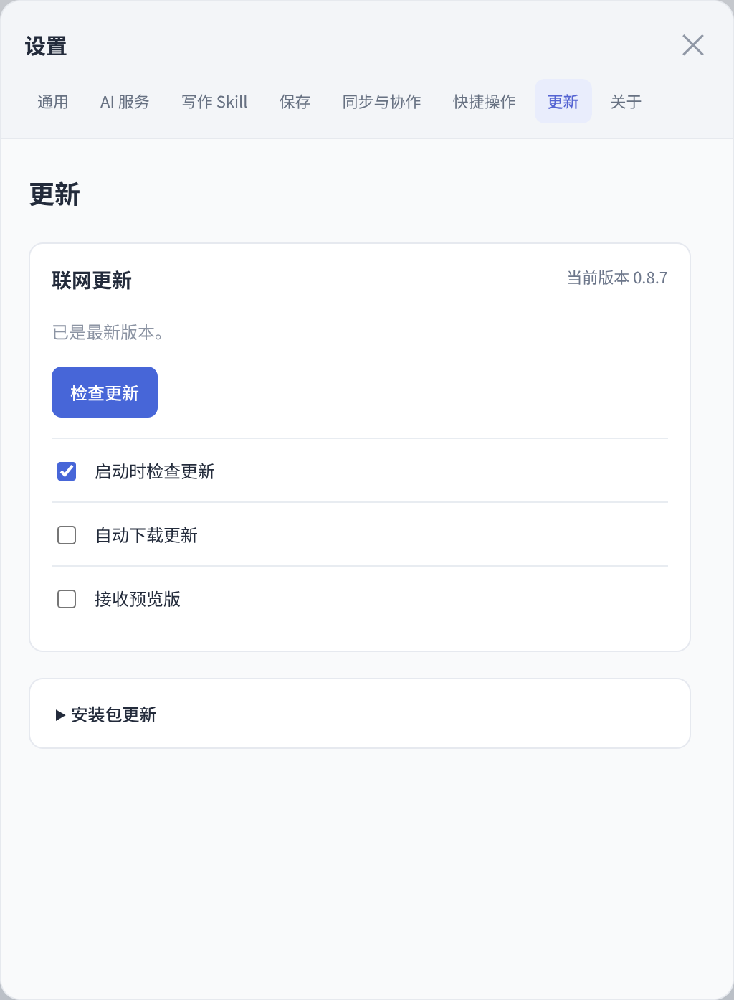
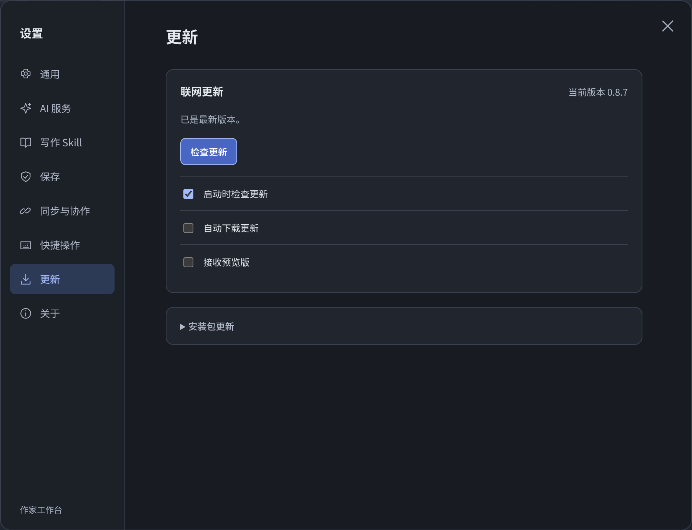

# 作家工作台 0.8.7 验收

## 本轮范围

设置中的「更新」默认显示联网更新卡片，当前版本在标题旁显示。检查、下载、保存后安装沿用原有更新服务，作者无须展开任何菜单即可进行联网更新。没有下载任务时突出「检查更新」，发现版本后突出下载或安装操作。

安装包更新位于下方默认折叠的备用入口。Linux 可选择本地 TAR 包，沿用校验与保存门禁；Windows、Mac 和 Linux 均提供固定 GitHub 发行页的安装包下载链接。只打开备用入口不会触发下载、安装或退出。已有本地暂存版本时自动展开重启入口，避免隐藏待完成的升级。

重开设置或切换分类沿用同一联网组件和订阅，不重建下载状态、已校验安装文件或偏好。网络自动检查、自动下载、预览版选择及文件校验保持原有行为，安装仍由作者点击确认并先保存。

## 隔离验收

默认主入口可达、平台能力矩阵、暂存包与保存失败门禁、切页和重开状态保留通过真实 DOM 与生产脚本检查。中英文、540 像素窄窗口和夜间布局以隔离 Electron 页面查看，使用生产 HTML、CSS 与组件，更新状态为模拟数据；未读取真实用户书稿或调用收费 AI。

四平台最终构建、下载校验与安装结果将在发行后记录。

## 界面

