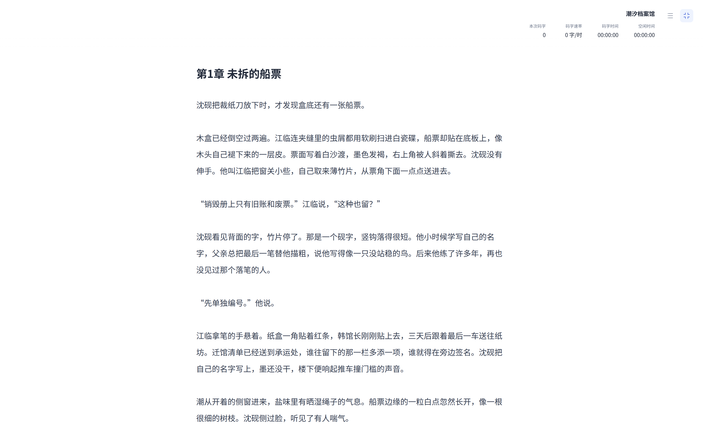
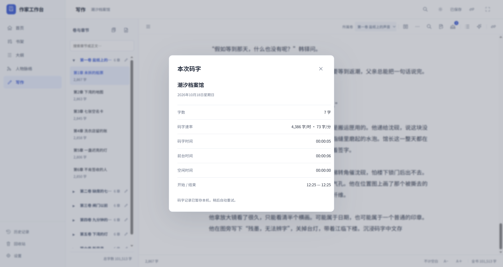
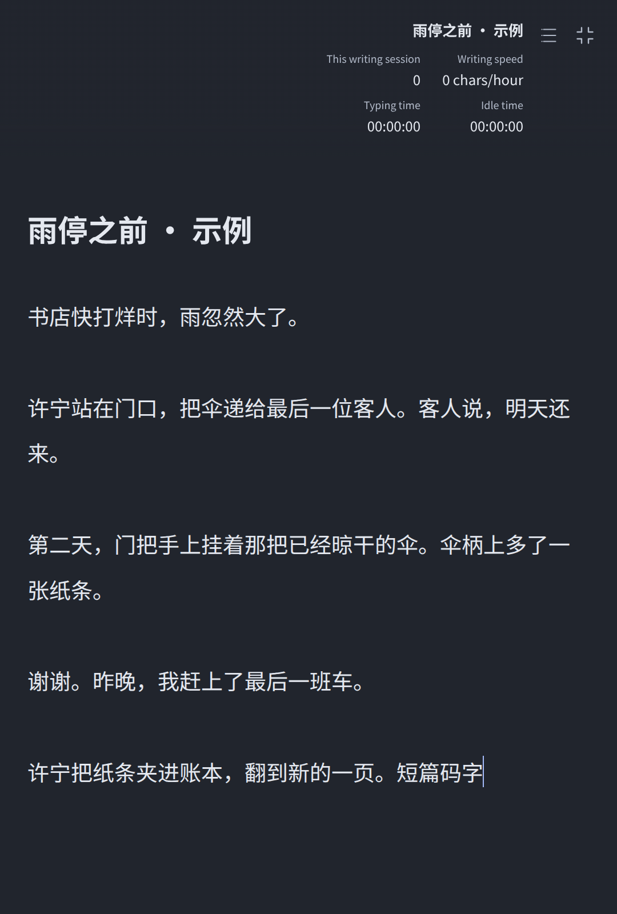

# 作家工作台 0.8.8 验收

## 本轮范围

写作中的沉浸式码字进入真正全屏，沿用同一正文编辑器，不复制或替换书稿。常用导航、章节目录、AI、状态栏与系统窗口按钮隐藏，只有作品大纲开关和退出两个图标。大纲可选择打开，退出后恢复进入前的窗口、侧栏与正文位置。

右上角显示书名、本次码字、每小时速率、码字时间与空闲时间。退出前先保存正文，再显示字数、时速 / 分速、输入时间、前台时间、空闲时间和开始 / 结束时间。首页显示汇总及最近 20 次记录，展开可查看各项数据。

## 统计口径与保存

本次码字只计正文中真实键入的非空白字符；中文输入法确认计一次，取消候选不计，粘贴、拖入、撤销重做、导入、恢复和 AI 内容不计新增码字。删除只计输入活动，不倒扣已键入量。它与原有首页的成功保存正文正增量独立。

连续 5 秒未输入正文后计为空闲；切到其他窗口立即计为空闲，返回后不延续上一段输入状态。输入与空闲时长合计为会话时长，前台时间另外记录，速率使用输入时长。记录按开始时的本机日期归档，跨午夜的会话仍可在最近记录查看。

会话只保存作品编号、标题快照、时间和计数，不保存正文；检查点与重试使用同一 UUID，避免重复累计。临时服务失败先保留本机待提交计数，恢复后重试。正文或统计均无法安全保留时不会隐藏编辑器。回收书籍暂不显示其统计，恢复后重新显示，彻底删除时清理对应记录。

## 隔离验收

真实 Electron 加载生产页面与保存服务，使用独立书库、空 Skill 来源和 101,506 字示例，检查全屏、仅两个可见图标、共享作品大纲、真实键盘输入、中文输入法提交与取消、保存失败仍可退出重试、退出汇总、首页记录、重启和 Esc。示例原文件的 SHA256 未改变。

另以独立原生 Electron 窗口检查普通窗口、最大化、原先全屏的恢复、系统退出全屏、快速连续进入退出、关闭前保存允许退出及监听清理。未触碰实际用户的 App 窗口、书库或付费 AI。

短篇进一步验证沿用单篇正文，无章节目录或章节标题，实际键入与保存不会增加章节。英文、夜间及 540 像素窗口检查统计和两个图标完整显示，退出摘要正常，无横向裁切。

本地 56 个 Node 测试文件通过。会话 API 检查包含持久化、幂等、错误输入、时区、鉴权、恢复和彻底删除；原首页与作品删除检查继续通过。各平台最终安装包与冻结后端结果在完成后补充。

## 界面

