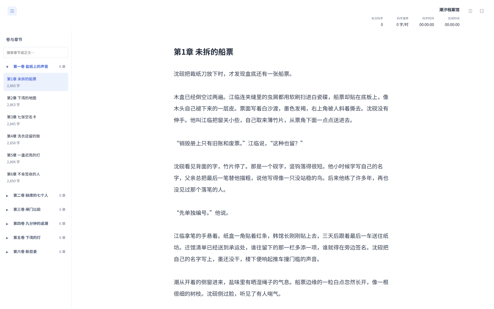
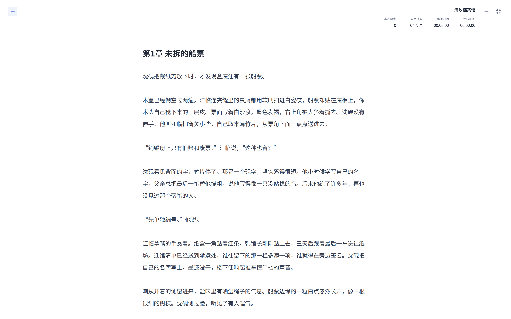
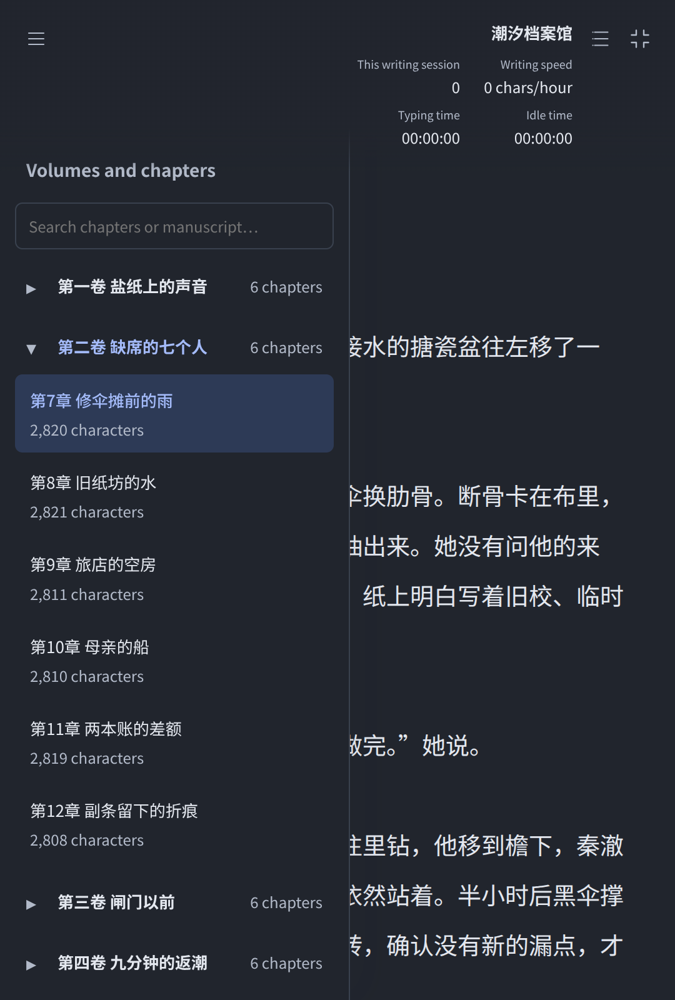

# 作家工作台 0.8.9 验收

## 本轮范围

长篇沉浸式码字默认显示原有卷章目录。左上角只有目录开关图标，可收起或展开；卷可折叠，章节可点击选择，保留搜索与每章字数。新建、编辑、重命名和重复统计等目录工具隐藏。右侧作品大纲、书名、本次码字与计时，以及退出图标继续保留，系统窗口按钮仍隐藏。

同书切章先保存当前正文，失败留在原章；输入法组合中或另一次切换未完成时不切章。新章载入后重置输入基线，本次统计器、记录编号与开始时间保持不变，第一下新输入正常计数，原有章节文字不算新增码字。退出仍生成一份汇总及首页记录。

左侧目录使用独立的沉浸布局状态，退出恢复普通写作时原有的目录显隐状态。窄窗口的目录和作品大纲轮流打开；选择章节后收起浮层，继续显示正文。短篇仍是一篇连续正文，不显示卷章目录或左上开关。

## 隔离检查

31 项码字模型与界面检查通过，包含跨章连续计数、切章保存失败、组合输入与切换保护、目标被删除、重复点击，以及等待保存时原生退出造成的竞争。26 项原生窗口、preload 与存储检查通过，包含 Mac 退出动画与窗口恢复尚未完成时的取消通知和状态读回。切章与退出共享临时正文锁，任何完成顺序都能恢复可编辑状态。全量 Node 检查共 541 项通过。

真实 Electron 使用生产页面、preload、原生控制器及主进程保存与 Esc 处理，运行独立书库和 101,506 字示例。跨卷切换前故意使保存失败，确认原章和所属卷保留；重试保存成功后载入新章，确认首字计入、两章合计 9 字保存为同一会话，两章正文分别正确保存。

另保持章节保存请求未完成，按原生 Esc，确认先退出系统全屏，保存完成后显示汇总，迟到切章不再执行，正文恢复可编辑。测试同时检查卷折叠、目录收起的滚动与光标、普通目录状态恢复、短篇与英文夜间窄窗口。示例原文件 SHA256 不变，未使用用户真实书库进行测试。

## 发行状态

四平台最终构建、独立文件校验与公开更新通道结果完成后补充。

## 界面

